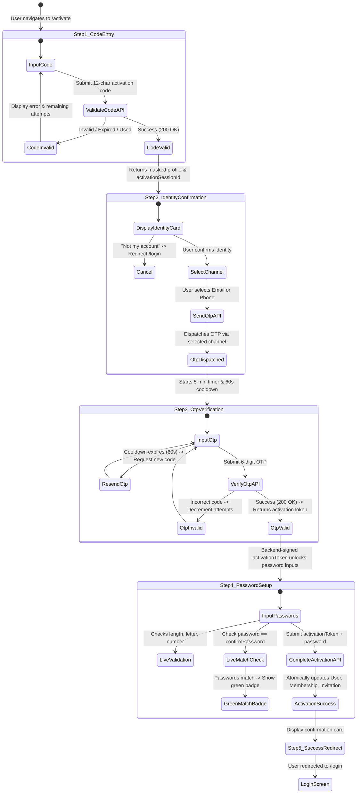

# ACADEX CAMPUS MANAGEMENT APPLICATION
## PHASE: AUTHENTICATION REVAMP — PROMPT 1 OF 5
### FORENSIC AUDIT OF EXISTING AUTHENTICATION AND ACTIVATION

**Document ID:** `ACADEX_AUTH_REVAMP_PROMPT_1_AUDIT.md`  
**Date:** 2026-10-14  
**Audit Scope:** Full-stack inspection of Node.js/TypeScript Express backend, MongoDB Atlas data layer, and Flutter Riverpod application.  
**Mode:** AUDIT-ONLY (Zero code, data, environment, or account modifications performed).

---

## EXECUTIVE SUMMARY

ACADEX is modernizing its first-time account activation and login architecture to eliminate the friction of requiring an institutional College Code and Student/Employee ID (`instituteId`) during activation. The target experience allows an invited person to input solely an **Activation Code**, view their masked identity confirmation, select their preferred delivery channel (email or phone), verify a single-use OTP, set a password with live matching feedback, and seamlessly proceed to the common login screen. Existing activated users must continue using their current credentials without disruption, and multi-college memberships must reuse the same canonical User identity without duplicate accounts or password overwrites.

This forensic audit inspected the live codebase and production MongoDB Atlas database to establish a verified baseline, document all defects, analyze database records across 10 categories, define the canonical identity model, and structure an actionable implementation roadmap for Prompts 2 through 5.

---

## 1. CURRENT AUTHENTICATION ARCHITECTURE

### 1.1 Canonical User Model & Identity Fields
- **Source File:** [`Backend/src/models/user.model.ts`](file:///Users/poornesh/Campus%20Management%20Main/Backend/src/models/user.model.ts)
- **Primary Technical Identity:** MongoDB ObjectId `_id`. All internal relational foreign keys, enrollments, attendance sessions, and role assignments point to `_id`.
- **Institutional Identity (`instituteId`):**
  - String, uppercase, trimmed, unique, sparse index (`{ instituteId: 1 }, { unique: true, sparse: true }`).
  - Represents the college roll number or employee ID (e.g., `24018-CM-062`, `SBCE-001`).
  - Can be updated administratively without disconnecting academic records.
- **Contact Identifiers:**
  - `email`: String, lowercase, trimmed, unique, sparse index (`{ email: 1 }, { unique: true, sparse: true }`).
  - `phone`: String, trimmed, unique, sparse index (`{ phone: 1 }, { unique: true, sparse: true }`).
- **Core Credentials & Lifecycle:**
  - `passwordHash`: String (bcrypt hash), default `null`.
  - `accountStatus`: Enum [`active`, `pending_activation`, `deactivated`, `inactive`, `suspended`], default `active`.
  - `activationStatus`: Enum [`pending`, `activated`, `deactivated`], default `activated`.
  - `lastLoginAt`: Date, default `null`.
  - `firebaseUid`: String, sparse index, legacy migration field (no longer authoritative).
  - Deprecated legacy placement fields: `courseId`, `sectionId`, `semesterId` (authoritative placement is managed via `StudentEnrollment`).

### 1.2 Password Hashing & Policy Validation
- **Source File:** [`Backend/src/services/password.service.ts`](file:///Users/poornesh/Campus%20Management%20Main/Backend/src/services/password.service.ts)
- **Hashing Engine:** `bcryptjs` with configurable rounds (`env.BCRYPT_SALT_ROUNDS = 10`).
- **Policy Enforcement:**
  - Minimum length: 8 characters; maximum: 128 characters.
  - Requires at least one letter (`/[a-zA-Z]/`) and at least one digit (`/[0-9]/`).
  - Verification uses timing-safe bcrypt comparison (`bcrypt.compare`).

### 1.3 Login & Logout Flows
- **Source Files:**
  - Controller: [`Backend/src/controllers/auth.controller.ts`](file:///Users/poornesh/Campus%20Management%20Main/Backend/src/controllers/auth.controller.ts#L11-L74)
  - Service: [`Backend/src/services/auth.service.ts`](file:///Users/poornesh/Campus%20Management%20Main/Backend/src/services/auth.service.ts#L49-L296)
  - Routes: [`Backend/src/routes/v1/auth.routes.ts`](file:///Users/poornesh/Campus%20Management%20Main/Backend/src/routes/v1/auth.routes.ts#L18-L35)
- **Login Endpoint:** `POST /api/v1/auth/login` (Rate limited: 15 req/5 min).
  - Request body: `{ identifier, password }`.
  - `normalizeIdentifier` identifies input format:
    - Email format (`type === 'email'`) -> queries `{ email: normalized }`.
    - Phone or alphanumeric format -> queries `{ $or: [{ phone: normalized }, { instituteId: normalized }] }`.
  - Enforces `accountStatus === AccountStatus.ACTIVE` (rejects `DEACTIVATED`, `PENDING_ACTIVATION`, or `INACTIVE`).
  - For tenant users (`role !== SUPER_ADMIN`), checks referenced `College` is `ACTIVE`.
  - Verifies bcrypt password hash.
  - Generates UUID v4 `sessionId`.
  - Persists `AuthSession` document in MongoDB.
  - Signs HMAC-SHA256 JWT Access Token and Refresh Token.
- **Logout Endpoints:**
  - `POST /api/v1/auth/logout`: Revokes single session (`revokedAt = new Date()`), disconnects active realtime WebSockets.
  - `POST /api/v1/auth/logout-all`: Revokes all active sessions for the user (`revokedAt = new Date()`), severs all user sockets.

### 1.4 Access Token & Refresh Token Mechanics
- **Source File:** [`Backend/src/utils/token.ts`](file:///Users/poornesh/Campus%20Management%20Main/Backend/src/utils/token.ts)
- **Access Token:** Signed with `JWT_ACCESS_SECRET`, TTL 900 seconds (15 minutes). Payload contains `userId`, `instituteId`, `email`, `phone`, `name`, `role`, `collegeId`, `departmentId`, `sessionId`.
- **Refresh Token:** Signed with `JWT_REFRESH_SECRET`, TTL 604,800 seconds (7 days). Payload contains `userId`, `sessionId`, `role`.
- **Token Refresh (`POST /api/v1/auth/refresh`):**
  - Verifies JWT refresh token.
  - Retrieves `AuthSession` by `sessionId`.
  - Confirms session is not revoked (`revokedAt == null`) and not expired (`now <= expiresAt`).
  - Validates SHA-256 hash of presented refresh token matches stored `refreshTokenHash`.
  - Confirms user and college remain active.
  - Updates `session.lastUsedAt` and issues fresh Access Token.

### 1.5 AuthSession Lifecycle
- **Source File:** [`Backend/src/models/authSession.model.ts`](file:///Users/poornesh/Campus%20Management%20Main/Backend/src/models/authSession.model.ts)
- **Document Structure:** `userId`, `sessionId` (UUID v4), `refreshTokenHash` (SHA-256), `userAgent`, `ipAddress`, `expiresAt`, `revokedAt`, `lastUsedAt`.
- **Indexes:**
  - Unique index: `{ sessionId: 1 }`.
  - Compound lookup: `{ userId: 1, revokedAt: 1 }`.
  - Native TTL auto-purge: `{ expiresAt: 1 }, { expireAfterSeconds: 0 }`.

### 1.6 Workspace Membership & Role Architecture
- **Source Files:**
  - Membership Model: [`Backend/src/models/workspaceMembership.model.ts`](file:///Users/poornesh/Campus%20Management%20Main/Backend/src/models/workspaceMembership.model.ts)
  - Role Assignment Model: [`Backend/src/models/workspaceRoleAssignment.model.ts`](file:///Users/poornesh/Campus%20Management%20Main/Backend/src/models/workspaceRoleAssignment.model.ts)
  - Middleware: [`Backend/src/middleware/auth.middleware.ts`](file:///Users/poornesh/Campus%20Management%20Main/Backend/src/middleware/auth.middleware.ts)
  - Compatibility Service: [`Backend/src/services/workspaceCompatibility.service.ts`](file:///Users/poornesh/Campus%20Management%20Main/Backend/src/services/workspaceCompatibility.service.ts)
- **Relationships:**
  - `WorkspaceMembership` establishes compound uniqueness: `{ userId: 1, collegeId: 1 }, { unique: true }`. A single human `User` has exactly one membership per college.
  - `WorkspaceRoleAssignment` establishes compound uniqueness: `{ membershipId: 1, role: 1, departmentId: 1 }, { unique: true }`. A user can hold multiple roles (e.g., Faculty in Dept A, HOD in Dept B) under the same institutional membership.
  - `WorkspaceCompatibilityService`: Provides lazy fallback during migration if `WorkspaceMembership` collection has not yet been populated for legacy users. If an authoritative membership document exists, it takes absolute precedence and legacy fields cannot override a suspended/revoked state.

### 1.7 Super Admin Platform Authority
- `AppRole.SUPER_ADMIN` (Level 100) operates system-wide without requiring an institutional `WorkspaceMembership`.
- In `auth.middleware.ts`, Super Admin can query platform-wide resources or switch into any college context (`req.tenant.isSuperAdmin = true`, `req.workspace.isSuperAdmin = true`).

### 1.8 Rate Limiting & Abuse Prevention
- **Source File:** [`Backend/src/middleware/rateLimiter.middleware.ts`](file:///Users/poornesh/Campus%20Management%20Main/Backend/src/middleware/rateLimiter.middleware.ts)
- Sliding-window in-memory limiter with 5-minute expired record cleanup.
- Configured limiters:
  - `loginRateLimiter`: 15 req / 5 min
  - `forgotPasswordRateLimiter`: 10 req / 10 min
  - `otpVerifyRateLimiter`: 15 req / 5 min
  - `resetPasswordRateLimiter`: 10 req / 10 min
  - `activationRateLimiter`: 15 req / 10 min
  - `changePasswordRateLimiter`: 5 req / 10 min
  - `invitationCreationRateLimiter`: 30 req / 5 min
  - `invitationReissueRateLimiter`: 15 req / 5 min

### 1.9 Flutter Client Integration
- **Network Layer:** [`Frontend/lib/core/network/api_client.dart`](file:///Users/poornesh/Campus%20Management%20Main/Frontend/lib/core/network/api_client.dart)
  - Custom Dio interceptor attaches `Authorization: Bearer <token>` and `X-Workspace-Id: <id>`.
  - Automatic 401 interception triggers token refresh on an isolated Dio client, writes new tokens to `FlutterSecureStorage`, and retries the original request.
  - Workspace epoch tracking rejects in-flight responses originating from prior workspace switches.
- **State Management:** [`Frontend/lib/features/auth/presentation/providers/auth_provider.dart`](file:///Users/poornesh/Campus%20Management%20Main/Frontend/lib/features/auth/presentation/providers/auth_provider.dart)
  - Riverpod `StateNotifier<AuthState>` (`AuthInitial`, `AuthProfileLoading`, `AuthLoading`, `AuthAuthenticated`, `AuthUnauthenticated`, `AuthError`).
  - Startup `_restoreSession()` reads secure storage, restores cached user, and validates against `GET /api/v1/auth/me`.
- **Routing:** [`Frontend/lib/app/router/app_router.dart`](file:///Users/poornesh/Campus%20Management%20Main/Frontend/lib/app/router/app_router.dart)
  - GoRouter redirect guard redirects unauthenticated users to `/login`, while exempting public routes (`/login`, `/activate`, `/forgot-password`, `/verify-otp`, `/reset-password`).

---

## 2. CURRENT ACTIVATION AND INVITATION BEHAVIOR

### 2.1 Existing Activation Mechanism
- **Model:** [`Backend/src/models/invitation.model.ts`](file:///Users/poornesh/Campus%20Management%20Main/Backend/src/models/invitation.model.ts)
  - Fields: `userId`, `collegeId`, `departmentId`, `role`, `codeHash`, `status` (`pending`, `used`, `expired`, `revoked`), `expiresAt`, `createdBy`, `usedAt`, `revokedAt`, `attemptCount`.
  - Single-use code generation: [`Backend/src/utils/activationCode.ts`](file:///Users/poornesh/Campus%20Management%20Main/Backend/src/utils/activationCode.ts)
    - Generates 12 random characters from `CHARSET = '23456789ABCDEFGHJKMNPQRSTUVWXYZ'` (excluding confusing chars `0, O, 1, I, L`), grouped as `XXXX-XXXX-XXXX`.
    - Hashed via deterministic HMAC-SHA256: `crypto.createHmac('sha256', env.ACTIVATION_CODE_SECRET).update(normalized).digest('hex')`.
    - Stored as `codeHash` with an index: `InvitationSchema.index({ codeHash: 1 })`.

### 2.2 Provisioning Pipeline (`POST /api/v1/auth/invitations`)
- Handled in [`invitation.service.ts:createInvitation`](file:///Users/poornesh/Campus%20Management%20Main/Backend/src/services/invitation.service.ts#L310-L538):
  1. Validates provisioning hierarchy (Super Admin -> College Admin/HOD, College Admin -> HOD/Faculty/Student, HOD -> Student, Faculty -> Student).
  2. Queries existing User identities by `instituteId`, `email`, and `phone`. If conflicting identities are found across different users, rejects with 409 Conflict.
  3. If user is new: creates `User` document in `accountStatus = PENDING_ACTIVATION`, `activationStatus = 'pending'`, `passwordHash = null`.
  4. Creates `WorkspaceMembership` in `status = PENDING`.
  5. Creates `WorkspaceRoleAssignment` in `status = PENDING`.
  6. Generates 12-char activation code, stores HMAC hash in `Invitation`, sets 7-day expiration (`INVITATION_EXPIRES_IN = 604800`).
  7. Returns plaintext activation code to caller to distribute to user.

### 2.3 Current Activation Pipeline (`POST /api/v1/auth/activate`)
- Handled in [`invitation.service.ts:activateAccount`](file:///Users/poornesh/Campus%20Management%20Main/Backend/src/services/invitation.service.ts#L545-L688):
  1. Requires four fields: `{ collegeCode, instituteId, activationCode, password }`.
  2. Finds `College` by regex match on `code`.
  3. Finds `User` by regex match on `instituteId` or `email`.
  4. Finds latest pending `Invitation` for `userId` and `collegeId`.
  5. Validates `invitation.isExpired()`. If expired, marks `status = EXPIRED` and returns 400.
  6. Validates code hash using `verifyActivationCode(rawActivationCode, invitation.codeHash)`. If mismatch, increments `attemptCount` and returns 400.
  7. If new user: validates password policy, hashes password with bcrypt, updates `user.passwordHash`, transitions `user.accountStatus` to `ACTIVE`, transitions `user.activationStatus` to `'activated'`.
  8. Transitions `WorkspaceMembership` to `ACTIVE`.
  9. Transitions `WorkspaceRoleAssignment` to `ACTIVE`.
  10. Sets `invitation.status = USED`, `invitation.usedAt = new Date()`.
  11. Creates `AuditLog` entry (`ACCOUNT_ACTIVATED`).
  12. Returns success response.
- **Client Implementation:** [`Frontend/lib/features/auth/presentation/screens/activation_screen.dart`](file:///Users/poornesh/Campus%20Management%20Main/Frontend/lib/features/auth/presentation/screens/activation_screen.dart)
  - Step 1: User enters College Code, PIN Number, and Activation Code. (No backend call occurs on Step 1; data is cached in Riverpod state).
  - Step 2: User enters New Password and Confirm Password. Clicking "Activate Account" dispatches all 4 parameters simultaneously to `POST /api/v1/auth/activate`.
  - Step 3: Displays success screen with "Continue to Sign In" leading to `/login`.

---

## 3. EXISTING OTP AND CONTACT-VERIFICATION BEHAVIOR

### 3.1 Data Model
- **Source File:** [`Backend/src/models/otp.model.ts`](file:///Users/poornesh/Campus%20Management%20Main/Backend/src/models/otp.model.ts)
- Fields: `userId`, `purpose` (`password_reset`, `account_activation`, `phone_verification`, `email_verification`), `deliveryMethod` (`email`, `sms`), `destination`, `otpHash` (HMAC-SHA256 with `JWT_RESET_SECRET`), `expiresAt`, `attempts`, `consumedAt`.
- TTL Index: `{ expiresAt: 1 }, { expireAfterSeconds: 0 }`.

### 3.2 Service Implementation
- **Source File:** [`Backend/src/services/otp.service.ts`](file:///Users/poornesh/Campus%20Management%20Main/Backend/src/services/otp.service.ts)
- Generates 6-digit numeric code using `crypto.randomInt(100000, 999999)`.
- Hashes with HMAC-SHA256.
- Enforces 60-second resend cooldown (`OTP_RESEND_COOLDOWN = 60`).
- Enforces 10-minute expiration (`OTP_EXPIRES_IN = 600`).
- Enforces maximum 5 attempts (`OTP_MAX_ATTEMPTS = 5`).
- Consumes upon successful verification (`consumedAt = new Date()`).

### 3.3 Delivery Layer Status
- **Source File:** [`Backend/src/services/otpDelivery.service.ts`](file:///Users/poornesh/Campus%20Management%20Main/Backend/src/services/otpDelivery.service.ts)
- `DevOtpDeliveryAdapter`: In-memory development adapter storing last delivered code in a Map. Does not leak codes to logs.
- `EmailDeliveryAdapter`: Placeholder stub ("Future integration: AWS SES / Sendgrid / Nodemailer").
- `SmsDeliveryAdapter`: Placeholder stub ("Future integration: Twilio / AWS SNS / MSG91").
- **Audit Finding:** The system does not yet have production SMTP or SMS gateway credentials configured in `Backend/.env`. In production, OTP delivery requires a live provider or a fallback mechanism.

---

## 4. EXISTING PASSWORD RECOVERY BEHAVIOR

- **Source Files:**
  - Controller: [`Backend/src/controllers/auth.controller.ts#L119-L159`](file:///Users/poornesh/Campus%20Management%20Main/Backend/src/controllers/auth.controller.ts#L119-L159)
  - Service: [`Backend/src/services/auth.service.ts#L299-L427`](file:///Users/poornesh/Campus%20Management%20Main/Backend/src/services/auth.service.ts#L299-L427)
  - Flutter Screen: [`Frontend/lib/features/auth/presentation/screens/forgot_password_screen.dart`](file:///Users/poornesh/Campus%20Management%20Main/Frontend/lib/features/auth/presentation/screens/forgot_password_screen.dart)
- **Step 1 (`POST /api/v1/auth/forgot-password`):** Takes `identifier` (email or phone). Anti-enumeration protection always returns generic success message. If user exists and is active, calls `OtpService.requestOtp(..., OtpPurpose.PASSWORD_RESET, ...)`.
- **Step 2 (`POST /api/v1/auth/verify-password-reset-otp`):** Takes `identifier` and `otp`. Verifies and consumes OTP via `OtpService.verifyAndConsumeOtp`. Signs short-lived JWT `resetToken` (10 minutes) with payload `{ userId, instituteId, email, role, collegeId }`.
- **Step 3 (`POST /api/v1/auth/reset-password`):** Takes `resetToken` and `newPassword`. Verifies token signature, validates password policy, hashes password, updates `user.passwordHash`, and **revokes all existing active sessions** for the user (`AuthService.logoutAll(user.id)`).

---

## 5. EXISTING DATABASE RECORDS AUDIT

A read-only forensic script queried the live MongoDB Atlas database (`acadex`) at `2026-10-14T15:56:09Z`. Zero records were modified.

### 5.1 Aggregate Totals
| Entity | Total Document Count | Status Breakdown |
| :--- | :--- | :--- |
| **Colleges** | 3 | 3 Active (`SBCE`, `API-001`, `SVGP`) |
| **Users** | 30 | 29 Active, 1 Pending Activation, 0 Deactivated |
| **WorkspaceMemberships** | 0 | 0 documents in collection (legacy fallback active) |
| **WorkspaceRoleAssignments** | 0 | 0 documents in collection (legacy fallback active) |
| **Invitations** | 150 | 137 Used, 9 Pending (all expired by date), 4 Revoked |
| **AuthSessions** | 17 | 9 Active, 8 Revoked, 0 Expired |
| **OTPs** | 0 | 0 documents in collection |

### 5.2 User Distribution by Role
| AppRole | Count | Description |
| :--- | :--- | :--- |
| **SUPER_ADMIN** | 1 | Platform administrator |
| **COLLEGE_ADMIN** | 3 | Institutional administrators (1 per college) |
| **HOD** | 5 | Heads of Department across colleges |
| **FACULTY** | 11 | Teaching staff |
| **STUDENT** | 10 | Enrolled students (9 active, 1 pending) |
| **TOTAL** | **30** | |

### 5.3 Forensic Breakdown by Audit Category

#### Category A: Already Activated Accounts with Valid Credentials
- **Count:** 29 users (96.7% of all users).
- **Credentials:** All 29 have valid bcrypt `passwordHash` values.
- **Impact on Revamp:** These users must **never** be forced to reactivate. Their existing credentials must remain 100% operational on `/login`.

#### Category B: Existing Pending Accounts Awaiting Activation
- **Count:** 1 user (ID: `6ac3d2550d1cfe82de0cbb08`, `instituteId`: `24018-CM-062`, Role: `STUDENT`, College: `SVGP`).
- **State:** `accountStatus: 'pending_activation'`, `activationStatus: 'pending'`, `passwordHash: null`.
- **Contact:** Has registered email and registered phone number.
- **Impact on Revamp:** This user is the primary real-world candidate for the revamped activation flow.

#### Category C: Existing Invitations Associated with Pending Users
- **Count:** 9 pending invitations total.
- **Date Status:** All 9 have `expiresAt < now` (invitations expire 7 days after creation).
- **Association:** 1 invitation is associated with the pending user (`24018-CM-062`); 8 are historical invitations associated with users who were subsequently activated or superseded.
- **Impact on Revamp:** When the pending user enters their activation code, the backend must detect that the code is expired and instruct them to obtain a reissued code from their administrator (or admin reissuance must update the expiration).

#### Category D: Existing Users with Memberships in Multiple Colleges
- **Count:** 0 users currently hold memberships across multiple colleges.
- **Impact on Revamp:** The multi-college architecture (`WorkspaceMembership`) is present in models and middleware, but no user in production currently holds multiple colleges. The revamp will establish this capability cleanly without legacy conflicts.

#### Category E: Existing Users Invited to an Additional College
- **Count:** 0 records.

#### Category F: Records with Missing Contact Information
- **Missing Email:** 8 users (2 College Admins, 6 Students).
- **Missing Phone:** 22 users.
- **Missing Both Email and Phone:** 8 users.
- **Have Both Email and Phone:** 8 users.
- **Missing Institute ID:** 0 users (all 30 have `instituteId`).
- **CRITICAL AUDIT FINDING:** All 8 users missing both email and phone are **already activated with passwords** (`hasPassword: true`). They authenticate using their PIN Number (`instituteId`) and password. Because they are already active, they will never encounter first-time activation. However, for all **future** account provisioning, the backend must require at least one contact method (email or phone) to ensure OTP delivery is possible.

#### Category G: Duplicate or Conflicting Identities
- **Duplicate Emails:** 0 groups.
- **Duplicate Phones:** 0 groups.
- **Duplicate Institute IDs:** 0 groups.
- **Audit Finding:** The identity namespace is clean with zero collisions.

#### Category H: Existing Users with Legacy Authentication State
- **Firebase UID:** 0 users have `firebaseUid` populated (completely decoupled).
- **Status Mismatches:** 0 mismatches between `accountStatus` and `activationStatus`.

#### Category I: Consumed, Expired, or Revoked Invitations
- **Used (Consumed):** 137 invitations (all single-use consumed).
- **Revoked:** 4 invitations.
- **Expired by Date:** 150 invitations.
- **Attempt Counts:** Average attempt count on used invitations is 0.01; max attempts observed is 2.

#### Category J: Accounts with Suspended, Inactive, or Revoked Status
- **Suspended / Deactivated:** 0 users.
- **Inactive Colleges:** 0 colleges (all 3 colleges are active).

---

## 6. CONFIRMED DEFECTS AND EXACT SOURCE FILES

| ID | Severity | Defect Description | Exact Source File(s) |
| :--- | :--- | :--- | :--- |
| **DEF-1** | **High** | **Activation requires College Code and Institute ID:** Backend `activateAccount` and frontend `ActivationScreen` mandate that users enter their institutional college code and PIN Number alongside the activation code. | [`Backend/src/services/invitation.service.ts#L545-L555`](file:///Users/poornesh/Campus%20Management%20Main/Backend/src/services/invitation.service.ts#L545-L555)<br>[`Frontend/lib/features/auth/presentation/screens/activation_screen.dart#L261-L285`](file:///Users/poornesh/Campus%20Management%20Main/Frontend/lib/features/auth/presentation/screens/activation_screen.dart#L261-L285) |
| **DEF-2** | **High** | **No identity confirmation or masked contact lookup:** There is no endpoint to inspect an activation code prior to activation to display the user's name, institution, and masked contacts for identity confirmation. | [`Backend/src/routes/v1/auth.routes.ts#L22-L24`](file:///Users/poornesh/Campus%20Management%20Main/Backend/src/routes/v1/auth.routes.ts#L22-L24)<br>[`Backend/src/services/invitation.service.ts`](file:///Users/poornesh/Campus%20Management%20Main/Backend/src/services/invitation.service.ts) |
| **DEF-3** | **Critical** | **Absence of OTP verification in activation lifecycle:** Account activation transitions directly from code to password setup without verifying possession of the registered email or phone number. | [`Backend/src/services/invitation.service.ts#L609-L628`](file:///Users/poornesh/Campus%20Management%20Main/Backend/src/services/invitation.service.ts#L609-L628)<br>[`Frontend/lib/features/auth/presentation/screens/activation_screen.dart`](file:///Users/poornesh/Campus%20Management%20Main/Frontend/lib/features/auth/presentation/screens/activation_screen.dart) |
| **DEF-4** | **High** | **Potential client-side claim vulnerability:** If OTP verification is not cryptographically coupled to activation completion via a backend-signed token, an attacker could bypass OTP verification and call the completion endpoint directly. | [`Backend/src/services/invitation.service.ts`](file:///Users/poornesh/Campus%20Management%20Main/Backend/src/services/invitation.service.ts) |
| **DEF-5** | **Medium** | **In-memory OTP delivery only:** `OtpDeliveryService` uses `DevOtpDeliveryAdapter`. Real SMTP or SMS gateway credentials are not configured in `.env`. | [`Backend/src/services/otpDelivery.service.ts#L20-L40`](file:///Users/poornesh/Campus%20Management%20Main/Backend/src/services/otpDelivery.service.ts#L20-L40) |
| **DEF-6** | **Medium** | **Provisioning permits missing contact details:** `CreateInvitationInput` treats `email` and `phone` as optional. Creating a user without contact details makes OTP delivery impossible during activation. | [`Backend/src/services/invitation.service.ts#L22-L33`](file:///Users/poornesh/Campus%20Management%20Main/Backend/src/services/invitation.service.ts#L22-L33) |
| **DEF-7** | **Medium** | **Zero `WorkspaceMembership` documents for existing users:** All 30 existing users rely on legacy fallback in `WorkspaceCompatibilityService`. Inviting an existing user to a second college requires initializing their primary membership first. | [`Backend/src/services/workspaceCompatibility.service.ts`](file:///Users/poornesh/Campus%20Management%20Main/Backend/src/services/workspaceCompatibility.service.ts) |
| **DEF-8** | **Low** | **Frontend lacks live "Passwords matched" visual badge:** `ActivationScreen` only validates password matching on form submission error text, rather than showing a live, real-time green indicator. | [`Frontend/lib/features/auth/presentation/screens/activation_screen.dart#L468-L502`](file:///Users/poornesh/Campus%20Management%20Main/Frontend/lib/features/auth/presentation/screens/activation_screen.dart#L468-L502) |

---

## 7. PROPOSED ACTIVATION STATE MACHINE



### State Machine Transition Rules
1. **Single-Use Activation Code:**
   - Evaluated by `hashActivationCode(rawCode)`.
   - Must match a document in `Invitation` where `status == 'pending'` and `expiresAt > now`.
   - Failed attempts increment `invitation.attemptCount`.
2. **Channel Masking:**
   - Email: `j***e@domain.com` (first char, asterisks, last char before `@`, full domain).
   - Phone: `+91 ••••• ••123` (country code and last 3 digits exposed).
3. **Cryptographic Activation Session Token:**
   - `validate-code` returns a short-lived `activationSessionId` (signed JWT, 15-minute expiry) containing `{ invitationId, userId, collegeId }`.
   - Prevents client tampering with user identity across steps.
4. **Cryptographic Activation Authorization Token:**
   - `verify-otp` returns a short-lived `activationToken` (signed JWT, 10-minute expiry) containing `{ invitationId, userId, collegeId, verifiedChannel }`.
   - The backend `complete` endpoint **requires** this token, ensuring password setup cannot be called without verified OTP.
5. **Existing Active User Bypass:**
   - If `user.accountStatus === 'active'` and `user.passwordHash != null`, Step 4 detects existing credentials:
   - Informs user: *"You already have an active ACADEX account. Your existing password will remain your login credential."*
   - Completing activation creates/activates `WorkspaceMembership` and `WorkspaceRoleAssignment` for the new college without overwriting the existing password.

---

## 8. PROPOSED API CONTRACT

### 8.1 Step 1: Validate Activation Code
- **Method & Route:** `POST /api/v1/auth/activation/validate-code`
- **Access:** Public (Protected by `activationRateLimiter`)
- **Request Body:**
  ```json
  {
    "code": "ACX7-KP92-M4QT"
  }
  ```
- **Response (200 OK):**
  ```json
  {
    "success": true,
    "message": "Activation code verified successfully",
    "data": {
      "activationSessionId": "eyJhbGciOi...",
      "name": "Jane Doe",
      "collegeName": "S V Government Polytechnic, Tirupati",
      "collegeCode": "SVGP",
      "role": "STUDENT",
      "isExistingActiveUser": false,
      "availableChannels": [
        {
          "type": "email",
          "masked": "j***e@gmail.com"
        },
        {
          "type": "sms",
          "masked": "+91 ••••• ••456"
        }
      ]
    }
  }
  ```
- **Error Responses:**
  - `400 Bad Request`: `"Invalid activation code"` / `"Activation code has expired. Please contact your administrator."`
  - `400 Bad Request`: `"This activation code has already been used."`
  - `403 Forbidden`: `"Account has been deactivated. Please contact your administrator."`
  - `429 Too Many Requests`: `"Too many activation attempts. Please try again in 10 minutes."`

### 8.2 Step 2: Send OTP
- **Method & Route:** `POST /api/v1/auth/activation/send-otp`
- **Access:** Public (Protected by `forgotPasswordRateLimiter`)
- **Request Body:**
  ```json
  {
    "activationSessionId": "eyJhbGciOi...",
    "channel": "email"
  }
  ```
- **Response (200 OK):**
  ```json
  {
    "success": true,
    "message": "Verification code has been sent to your registered email.",
    "data": {
      "cooldownSeconds": 60,
      "expiresInSeconds": 600
    }
  }
  ```
- **Error Responses:**
  - `400 Bad Request`: `"Invalid activation session. Please re-enter your activation code."`
  - `400 Bad Request`: `"Selected contact method is not available on this account."`
  - `429 Too Many Requests`: `"Please wait 45 seconds before requesting another code."`

### 8.3 Step 3: Verify OTP
- **Method & Route:** `POST /api/v1/auth/activation/verify-otp`
- **Access:** Public (Protected by `otpVerifyRateLimiter`)
- **Request Body:**
  ```json
  {
    "activationSessionId": "eyJhbGciOi...",
    "otp": "481920"
  }
  ```
- **Response (200 OK):**
  ```json
  {
    "success": true,
    "message": "Verification code verified successfully.",
    "data": {
      "activationToken": "eyJhbGciOi...",
      "isExistingActiveUser": false
    }
  }
  ```
- **Error Responses:**
  - `400 Bad Request`: `"Invalid verification code. 3 attempts remaining."`
  - `400 Bad Request`: `"Verification code has expired. Please request a new code."`
  - `429 Too Many Requests`: `"Maximum verification attempts exceeded. Please request a new code."`

### 8.4 Step 4: Complete Activation
- **Method & Route:** `POST /api/v1/auth/activation/complete`
- **Access:** Public (Protected by `activationRateLimiter`)
- **Request Body (New User):**
  ```json
  {
    "activationToken": "eyJhbGciOi...",
    "password": "SecurePassword123"
  }
  ```
- **Request Body (Existing Active User):**
  ```json
  {
    "activationToken": "eyJhbGciOi..."
  }
  ```
- **Response (200 OK):**
  ```json
  {
    "success": true,
    "message": "Account activated successfully. You may now sign in with your credentials.",
    "data": {
      "user": {
        "id": "6ac3d2550d1cfe82de0cbb08",
        "instituteId": "24018-CM-062",
        "name": "Jane Doe",
        "role": "STUDENT",
        "collegeCode": "SVGP",
        "accountStatus": "active"
      }
    }
  }
  ```
- **Error Responses:**
  - `400 Bad Request`: `"Password is required to activate a new account."`
  - `400 Bad Request`: `"Password must be at least 8 characters long and contain at least one letter and one number."`
  - `401 Unauthorized`: `"Invalid or expired activation authorization token."`

### 8.5 Backward Compatibility Route
- `POST /api/v1/auth/activate` will remain operational as a legacy wrapper during the transition period, calling internal service routines cleanly.

---

## 9. MIGRATION AND BACKWARD-COMPATIBILITY REQUIREMENTS

1. **Zero Credential Invalidation for Existing Activated Users:**
   - The 29 active users in MongoDB Atlas have valid bcrypt password hashes and verified logins. None of these accounts will be transitioned to pending or prompted for reactivation.
2. **Support for Existing Identifier Login:**
   - Existing users without registered email/phone (8 users) authenticate via `instituteId` (PIN Number) and password. Login query logic in `AuthService.login` must maintain support for PIN Number login.
3. **Lazy WorkspaceMembership Initialization:**
   - For existing users who authenticate and lack a `WorkspaceMembership` document, `auth.middleware.ts` / `workspaceCompatibility.service.ts` will lazily instantiate the canonical `WorkspaceMembership` and `WorkspaceRoleAssignment` from their primary college, eliminating the need for an upfront database migration script that could alter production records.
4. **Existing Session Integrity:**
   - Active `AuthSession` documents (9 active in production) will not be purged or invalidated by the activation revamp.

---

## 10. FOCUSED IMPLEMENTATION PLAN (PROMPTS 2–5)

```
=============================================================================
PROMPT 2: BACKEND ACTIVATION CORE & MULTI-STEP PIPELINE
=============================================================================
1. Build `ActivationService`:
   - `validateActivationCode(rawCode)`: Hash HMAC-SHA256, look up invitation by codeHash without requiring collegeCode/instituteId.
   - Return masked contact details & sign short-lived `activationSessionId`.
   - `sendActivationOtp(activationSessionId, channel)`: Route OTP to OtpService with OtpPurpose.ACCOUNT_ACTIVATION.
   - `verifyActivationOtp(activationSessionId, otp)`: Consume OTP & sign short-lived `activationToken`.
   - `completeActivation(activationToken, password?)`: Atomically update User, WorkspaceMembership, WorkspaceRoleAssignment, and Invitation.
2. Register endpoints in `auth.routes.ts` & `auth.controller.ts`.
3. Integrate rate limiters: `activationRateLimiter`, `otpVerifyRateLimiter`, `forgotPasswordRateLimiter`.
4. Unit and API integration tests in `Backend/tests`.

=============================================================================
PROMPT 3: EXISTING-USER MULTI-COLLEGE & EDGE CASE HARDENING
=============================================================================
1. Multi-College Invitation Handling:
   - Detect if invited user is already ACTIVE in another college.
   - For existing active users, complete activation without requiring a new password or modifying `user.passwordHash`.
   - Establish `WorkspaceMembership` and `WorkspaceRoleAssignment` for the additional college.
2. Provisioning Validation Enhancement:
   - Update `createInvitation` validation to require at least one valid contact method (email OR phone) for new user accounts.
3. Automated Lazy Migration Hook:
   - Lazily ensure canonical `WorkspaceMembership` exists upon user login.
4. Concurrency & Replay Attack Defense:
   - Add atomic condition to mark invitation as USED (`findOneAndUpdate({ _id, status: 'pending' })`).

=============================================================================
PROMPT 4: FLUTTER ACTIVATION UI REVAMP
=============================================================================
1. Redesign `ActivationScreen` into the 4-step interactive flow:
   - Step 1: Activation Code input ONLY (removes College Code and PIN Number fields).
   - Step 2: Identity Confirmation Card displaying person's name, college name/code, and masked email/phone with channel selection.
   - Step 3: OTP Verification with 5-minute countdown and 60-second resend cooldown timer.
   - Step 4: Password Setup with live policy checklist and prominent green "Passwords matched" indicator.
2. Update `ActivationNotifier` and `ApiAuthRepository`:
   - Methods: `validateCode()`, `sendOtp()`, `verifyOtp()`, `completeActivation()`.
3. Smooth transition to `/login` upon activation completion.
4. Mobile responsiveness, dark mode compliance, and Riverpod cache management.

=============================================================================
PROMPT 5: END-TO-END VERIFICATION, SECURITY HARDENING & ACCEPTANCE
=============================================================================
1. Comprehensive test suites:
   - Backend integration tests covering code validation, channel masking, OTP resend cooldowns, attempt lockouts, single-use consumption, and password updates.
   - Frontend widget & flow tests covering all 4 steps, timer countdowns, green password matching feedback, and error handling.
2. Anti-enumeration and brute-force verification.
3. Verification of existing 29 activated user logins to confirm zero regressions.
4. Clean production readiness report.
```

---

## 11. SECURITY RISKS AND UNRESOLVED QUESTIONS

### 11.1 Security Risks & Mitigations
1. **Activation Code Brute-Force:**
   - *Risk:* 12-character code space ($32^{12} \approx 1.15 \times 10^{18}$) is vast, but automated crawlers could attempt brute-forcing.
   - *Mitigation:* `activationRateLimiter` limits requests to 15 per 10 minutes per IP. Any invitation receiving 5 failed attempts is locked out automatically.
2. **OTP Interception & Guessing:**
   - *Risk:* 6-digit numeric OTP ($10^6$) can be guessed if unlimited attempts are permitted.
   - *Mitigation:* Strict 5-attempt limit per OTP document (`OTP_MAX_ATTEMPTS`), 10-minute expiry, and single-use atomic consumption (`consumedAt = new Date()`).
3. **Decoupled Step Spoofing:**
   - *Risk:* Calling the completion endpoint without verifying the OTP.
   - *Mitigation:* The completion endpoint strictly requires a backend-signed JWT `activationToken` with HMAC-SHA256 signature that is issued exclusively by `verify-otp`.
4. **Account Enumeration via Masked Data:**
   - *Risk:* Entering arbitrary activation codes to discover names and institutions.
   - *Mitigation:* Codes are 12 characters, and rate limiting halts automated enumeration. Contacts are heavily masked (e.g. `j***e@gmail.com`).

### 11.2 Unresolved Questions & Clarifications
1. **Production Email / SMS Gateway Credentials:**
   - While the development environment uses `DevOtpDeliveryAdapter`, production deployments will require SMTP (AWS SES / Sendgrid) or SMS (Twilio / MSG91) credentials to dispatch live OTPs. Should we configure fallback logging for staging/preview environments?
2. **Multi-College Primary Workspace:**
   - When an existing user joins a second college via activation code, should the new college become their default active workspace (`isDefault: true`), or should their initial college remain default?
3. **Immediate Session Issuance Option:**
   - Step 10 specifies: *"User is redirected to the common ACADEX login screen"*. Should the activation completion response also return access/refresh tokens to enable an optional "Continue to Dashboard" quick-action, or strictly enforce manual re-entry of credentials on `/login`? (The architecture supports either).

---

## 12. CONCLUSION

The ACADEX authentication architecture possesses a robust foundation in its JWT session management, password hashing, RBAC hierarchy, and decoupled data models. The planned revamp resolves all key usability defects in first-time activation by removing the mandatory institutional ID, enforcing contact-verified OTP security, protecting identity continuity for multi-college users, and delivering live password-matching feedback. All findings in this audit are verified against the active source code and live database. Prompt 1 is complete.
