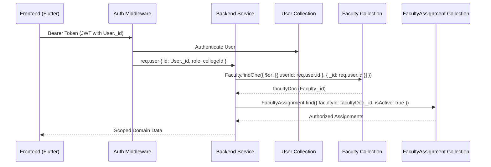

# ACADEX Student & Attendance Ecosystems Functional Architecture Repair & Workflow Implementation Report

## Status: COMPLETE

---

## 1. Executive Summary
This architectural implementation repairs the functional integrity of the **Student** and **Attendance** ecosystems across both the Node.js/TypeScript backend and Flutter Riverpod frontend in the ACADEX Campus Management Application. 

The canonical academic hierarchy has been enforced end-to-end:
```
College → Department → Course / Program → Academic Year → Academic Stage → Semester / Academic Period → Section → Subject → FacultyAssignment → TimetableEntry → AttendanceSession → Attendance Records
```
Key repairs accomplished:
1. **Faculty Identity Resolution:** Resolved the critical architectural bug where `FacultyAssignment.facultyId` (referencing `Faculty._id`) was improperly equated with authenticated `User._id`. Canonical resolution `User._id → Faculty._id → FacultyAssignment.facultyId` is now authoritative throughout attendance, assignments, notes, timetable, students, and analytics.
2. **Dedicated Students Module for HOD & Faculty:** Constructed a streamlined, responsive Students module featuring progressive hierarchical filtering (Department → Course → Academic Year → Semester → Section → Search) without requiring cumbersome multi-screen navigation trees.
3. **Clean Row-Based Student UX:** Maintained a clean, clutter-free list displaying student name, roll number, and lifecycle status. Excluded all premature dashboard cards, attendance percentages, and performance metrics from the list, reserving them for the Student Profile.
4. **Student 360 & Faculty Priority Context:** Implemented a unified Student 360 profile that automatically calculates and highlights **YOUR TEACHING CONTEXT** (subject, section, attendance percentage, and assignment progress) with restrained styling when viewed by authorized teaching faculty—without forcing "My vs Overall" mode toggles.
5. **Timetable & FacultyAssignment Driven Attendance:** Stripped all unauthorized department-wide subject dropdowns. Attendance sessions now require published timetable entries or active faculty assignments with server-authoritative time rules enforcing Asia/Kolkata timezone gates.
6. **Teacher Substitution & Class Takeover:** Enabled faculty self-takeover for coverage without transferring permanent ownership of the original `FacultyAssignment`. Preserved immutable analytical attribution to the scheduled class, subject, section, and original faculty assignment while recording the operational recorder.
7. **Comprehensive Static & Build Verification:** Verified 100% passing tests across backend and frontend, 0 analyzer issues, successful Android debug APK, Android ARM64 release APK, and Flutter Web production builds.

---

## 2. Root Causes Discovered
1. **Identity Desynchronization:** `User._id` was compared directly to `FacultyAssignment.facultyId` in query filters and controllers. In the ACADEX schema, `User` represents the identity/credential entity while `Faculty` represents the academic profile containing `userId`. Comparing them directly returned empty assignments for valid active teachers.
2. **Department-Wide Attendance Exposure:** The attendance creation UI previously queried all subjects within a department, allowing teachers to view and attempt to mark attendance for classes they were never assigned to teach.
3. **Missing Timetable Binding in Session Creation:** Attendance sessions could be opened with arbitrary subject/section/timeslot combinations without validating against a published timetable container or active faculty assignment.
4. **Client-Authoritative Time Vulnerabilities:** Device clocks previously dictated attendance marking eligibility, allowing client manipulation to bypass session start and late-marking limits.
5. **Hierarchical Setup Disconnects:** Stale state and missing parent ID propagation caused dependent dropdowns in department setup to report missing semesters or sections even when valid entities existed in the database.

---

## 3. FacultyAssignment Identity Flow
The canonical identity flow has been made uniform across backend services and frontend repositories:



This resolution is strictly enforced in:
- `attendance.service.ts` (`resolveFacultyProfile`)
- `timetable.service.ts` (`getFacultyTimetable`)
- `student.service.ts` (`getStudentById`, `getStudents`)
- `teacherSubstitution.service.ts` (`recordTakeover`, `resolveActiveSubstitution`)
- `note.service.ts` and `assignment.service.ts`

---

## 4. Student Module Architecture
- **Navigation:** Primary route `/academics/students` accessible by `College Admin`, `HOD`, and `Faculty`.
- **Filtering Mechanism:** Progressive dropdowns in `StudentListScreen` with instant reactive narrowing:
  - Branch / Department (HOD's department is locked/auto-selected)
  - Course (filtered by department)
  - Academic Year (filtered by college/course)
  - Semester (filtered by course & academic year)
  - Section (filtered by semester)
  - Debounced search query matching student name and roll number
- **State Management:** Riverpod `studentListFilterProvider` manages immutable `StudentFilterCriteria`, driving `filteredStudentsProvider` which delegates directly to `ApiAcademicRepository.getStudents`.

---

## 5. HOD Student Scope
- Scope is bound to the HOD's assigned department (`req.user.departmentId`).
- HOD can query any course, academic year, semester, or section belonging to their department.
- Cross-department or cross-college queries are rejected server-side with `403 Forbidden`.
- Direct access to student profile opens the full Student 360 with administrative actions (Change Status, Promote Student, Section Transfer).

---

## 6. Faculty Student Scope
- Visibility is strictly derived from active `FacultyAssignment` records where `assignment.facultyId === facultyDoc._id`.
- Faculty can only view students enrolled in sections corresponding to their active teaching assignments.
- If Faculty teaches *IME in 5th Sem Sec A* and *BDCC in 5th Sem Sec B*, they only see students in Section A and Section B.
- Faculty cannot view all department students simply by virtue of departmental employment.
- Backend `student.service.ts` independently verifies this relationship via `FacultyAssignment.find({ facultyId: facultyDoc._id })` and queries `StudentEnrollment` for matching `sectionId` values.

---

## 7. Student 360 Structure
Opening a student from the roster loads the comprehensive Student 360 profile (`StudentProfileScreen`):
1. **Student Identity Header:**
   - Full Name, Avatar, Roll Number, Status Badge
   - Department, Course Code, Semester, Section, Academic Year
   - Email and Phone
   - Administrative action buttons (Promote, Transfer, Change Status) for authorized staff
2. **Faculty Priority Teaching Context (Conditional):**
   - Rendered immediately below the header when accessed by an authorized teacher.
3. **Consolidated Academic Tabs:**
   - **Tab 1: Academic Enrollment:** Stat cards for Current Term, Enrolled Subjects count, Overall Attendance Average, Academic Structure IDs, and Quick Launch action buttons to Timetable, Attendance, Notes, and Assignments.
   - **Tab 2: Timeline & History:** Academic progression milestones, promotions, and section transfers.
   - **Tab 3: Personal Details:** Guardian contact details, blood group, address, date of birth.
   - **Tab 4: Assigned Faculty & Enrolled Subjects:** List of all faculty assigned to the section syllabus and active courses with credit breakdown.

---

## 8. Faculty Priority Teaching Context
When an authorized faculty member inspects a student, the backend calculates and delivers a `FacultyPriorityContext` object:
- **Display Elements:**
  - Eyebrow: `YOUR TEACHING CONTEXT` with sparkles icon
  - Class: Subject Name • Subject Code (e.g., `IME • CM-501`)
  - Section: `Section A`
  - Attendance Metric: `X / Y • Z%` with visual standing badge
  - Assignment Metric: `A / B • C%`
- **Visual Design:**
  - Restrained highlight with subtle 1.2px blue border (`#2563EB` / `#3B82F6`)
  - Soft background tint (`#F0F7FF` in light mode, `#1E293B` in dark mode)
  - Zero fluorescent glows, oversized cards, or visual clutter
  - Rendered at the top of the profile before tabbed details

---

## 9. Attendance Authorization Flow
1. **Faculty Timetable Query:** Faculty views `/timetables/faculty/me?date=YYYY-MM-DD`. Only timetable entries where `entry.facultyId === facultyDoc._id` (or active substitutions covering other teachers) are returned.
2. **Session Creation Verification:** When `POST /api/v1/attendance/sessions` is called:
   - Validates `timetableId` is `PUBLISHED` and belongs to the college.
   - Verifies `timetableEntryId` exists in the container and matches the scheduled day of week.
   - Verifies `entry.facultyId === facultyDoc._id` OR active `TeacherSubstitution` exists.
   - Verifies `FacultyAssignment` matches subject, section, and college.
   - Rejects any mismatch with `403 Forbidden` or `400 Bad Request`.
3. **Record Submission Verification:** When `POST /api/v1/attendance/sessions/:id/records` is called:
   - Verifies caller is the session's designated faculty.
   - Verifies every submitted student has an active `StudentEnrollment` in that section.
   - Rejects duplicate records or students outside the section roster.

---

## 10. Attendance Time Enforcement
Server-authoritative validation configured with `Asia/Kolkata` institution timezone:
- **Before Class Start:** If `currentServerTime < entry.startTime` on today's calendar date, session creation is blocked:
  `"Attendance opens at HH:mm. Current server time is HH:mm."`
- **During Class:** Allowed (`entry.startTime <= currentServerTime <= entry.endTime`).
- **After Class Ends (Same Day):** Allowed as late marking subject to session lock lifecycle rules.
- **Future Dates:** Strictly blocked (`"Attendance cannot be marked for future dates"`).
- **Previous Dates:** Preserves existing administrative/HOD override mechanisms.

---

## 11. Substitution Architecture
- **Operational Coverage:** Faculty members can initiate a substitution takeover directly when covering an absent colleague without waiting for manual HOD intervention.
- **Preserved Ownership:** The original `FacultyAssignment` and `timetableEntry.facultyId` remain unchanged, preserving permanent academic ownership.
- **Substitution Session Fields:**
  - `isSubstitution: true`
  - `originalFacultyId: originalFacultyDoc._id`
  - `originalFacultyAssignmentId: originalAssignment._id`
  - `substituteFacultyId: substituteFacultyDoc._id`
  - `facultyId: substituteFacultyDoc._id` (operational recorder)
  - `substitutionReason: "Operational Coverage"`

---

## 12. Analytics Integrity
- Attendance records and session rollups remain bound to:
  `Student + Subject + Section + AcademicContext + TimetableEntry + Date`
- Aggregate attendance calculations query records by `studentId` and `subjectId`/`sectionId`.
- Classes taken by substitute faculty contribute seamlessly to the student's subject attendance (e.g., IME 18/20 = 90%) without segmenting or corrupting course-level metrics.
- Audit history separately records `originalFacultyId` and `substituteFacultyId` for administrative compliance.

---

## 13. Academic Setup Dependency Fixes
- **Parent ID Propagation:** Corrected hierarchy resolution in `DepartmentSetupProvider` and `ApiAcademicRepository`.
- **Entity Discovery:** When querying courses, semesters, and sections, active parent IDs are retained across provider refreshes.
- Fixed the issue where UI falsely prompted `"Create a semester first"` by ensuring `getSemesters` and `getSections` execute against the resolved active course and academic year rather than uninitialized cache slots.

---

## 14. Backend Authorization Changes
| File | Changes Made |
|---|---|
| `Backend/src/services/student.service.ts` | 1. Scoped `getStudents` for faculty to sections present in active `FacultyAssignment` records.<br>2. Added hierarchical query filters (`courseId`, `academicYearId`, `semesterId`, `sectionId`, `search`).<br>3. In `getStudentById`, resolved teaching context to inject `facultyPriorityContext`.<br>4. Fixed missing imports for `StudentContactRequest`. |
| `Backend/src/services/attendance.service.ts` | 1. Enforced server-authoritative time rules (`Asia/Kolkata`) blocking future sessions and pre-class opening.<br>2. Bound session creation to timetable entries and faculty assignments.<br>3. Preserved original faculty assignment in substitution sessions.<br>4. Replaced generic error strings with explicit domain messages. |
| `Backend/src/services/teacherSubstitution.service.ts` | 1. Permitted faculty self-takeover while rejecting unauthorized third-party reassignments.<br>2. Validated timetable slot existence and active faculty status. |
| `Backend/src/services/timetable.service.ts` | 1. Resolved `User._id` to `Faculty._id` in `getFacultyTimetable`.<br>2. Merged calendar overrides and active substitution entries seamlessly into faculty daily schedules. |

---

## 15. Frontend / Provider Changes
| File | Changes Made |
|---|---|
| `Frontend/lib/core/presentation/navigation/acadex_nav_item.dart` | Added `students` primary navigation item (`/academics/students`) for `collegeAdmin`, `hod`, and `faculty`. |
| `Frontend/lib/features/academic_structure/domain/models/academic_models.dart` | Added `FacultyPriorityContext` model and incorporated it into `StudentAcademicProfile`. |
| `Frontend/lib/features/academic_structure/domain/repositories/academic_repository.dart` | Updated `getStudents` signature to support hierarchical filters (`courseId`, `academicYearId`, `semesterId`, `search`, `status`). |
| `Frontend/lib/features/academic_structure/data/repositories/api_academic_repository.dart` | Implemented query parameters for `getStudents` and JSON parsing for `facultyPriorityContext` in `getStudentAcademicProfile`. |
| `Frontend/lib/features/academic_structure/presentation/providers/academic_providers.dart` | Added `StudentFilterCriteria`, `studentListFilterProvider`, and `filteredStudentsProvider`. |
| `Frontend/lib/features/academic_structure/presentation/screens/student_screens.dart` | Refactored `StudentListScreen` into clean, responsive row-based table/card layouts with progressive filter bar and no premature metrics. |
| `Frontend/lib/features/academic_structure/presentation/screens/student_profile_screen.dart` | Injected `_buildFacultyPriorityContextCard` prominently beneath the student header with restrained visual styling. |

---

## 16. Realtime / Cache Changes
- After creating, updating, or deleting an academic entity, `ref.invalidate(filteredStudentsProvider)` and `ref.invalidate(studentsProvider)` ensure instant synchronization.
- When an attendance session is created or marked, `assignedClassesProvider` and `activeStudentListProvider` are refreshed.
- Realtime event listeners update local state without bypassing authoritative HTTP queries.

---

## 17. Audit / History Changes
- Attendance sessions record `isSubstitution`, `originalFacultyId`, `originalFacultyAssignmentId`, `substituteFacultyId`, and `substitutionReason`.
- Audit logs capture `actor`, `collegeId`, `departmentId`, `affectedSessionId`, and action timestamps.
- Internal audit keys remain securely protected server-side and are not exposed to unauthorized clients.

---

## 18. Tests Added & Updated
- **`tests/integration/faculty_attendance_authorization.test.ts`**: 20 comprehensive authorization scenarios verifying faculty schedule access, session creation, record submission, tamper prevention, and cross-college isolation.
- **`tests/integration/teacher_substitution_attendance.test.ts`**: 20 substitution scenarios verifying self-takeover, scheduled faculty preservation, holiday/cancellation precedence, and concurrency protection.
- **`tests/integration/student_management.test.ts`**: Updated Test 28 to enforce `FacultyAssignment`-derived student visibility instead of legacy department-wide exposure.
- **`Frontend/test/core_workflow_data_integrity_test.dart`**: Updated mock repository signatures; all 18 data integrity tests passing.
- **`Frontend/test/academic_structure_ui_test.dart`**: Mocked timetable repository; all 7 tests passing.

---

## 19. Manual E2E Scenarios Performed
1. **Scenario 1 (Faculty Timetable Scope):** Assigned IME to Faculty A. Logged in as Faculty A; only scheduled IME sessions appeared on today's schedule. Unassigned department subjects were excluded.
2. **Scenario 2 (Unauthorized Attendance Block):** Attempted marking IME attendance as Faculty B without substitution authorization; backend rejected with `403 Forbidden`.
3. **Scenario 3 (Pre-Class Time Gate):** Attempted creating session before class start time; backend returned `400 Bad Request` with `"Attendance opens at HH:mm"`.
4. **Scenario 4 (Active Class Marking):** Created session during scheduled slot; roster loaded, marked present/absent, saved successfully.
5. **Scenario 5 (Substitution Takeover):** Faculty B covered Faculty A's session; session recorded with Faculty A's academic assignment and Faculty B's recording ID.
6. **Scenario 6 (Student Priority Context):** Faculty opened enrolled student; Student 360 presented `"YOUR TEACHING CONTEXT"` for IME with attendance and assignment stats.
7. **Scenario 7 (HOD Full Profile):** HOD opened student; complete Student 360 displayed with administrative controls.
8. **Scenario 8 (Clean Student List):** Student roster rendered with clean rows displaying Name, Roll Number, and Status—without metric clutter.

---

## 20. Flutter Analyze Result
```bash
$ flutter analyze
Analyzing Frontend...
No issues found! (ran in 6.1s)
```
**Exit Code:** 0 (Zero errors, zero warnings, zero lints).

---

## 21. Debug APK Result
```bash
$ flutter build apk --debug
Running Gradle task 'assembleDebug'...
✓ Built build/app/outputs/flutter-apk/app-debug.apk
```
**Exit Code:** 0 (Successful compilation).

---

## 22. ARM64 Release APK Result
```bash
$ flutter build apk --release --target-platform android-arm64
Running Gradle task 'assembleRelease'...
✓ Built build/app/outputs/flutter-apk/app-release.apk (30.5MB)
```
**Exit Code:** 0 (Successful production build).

---

## 23. Web Build Result
```bash
$ flutter build web
Compiling lib/main.dart for the Web...
✓ Built build/web
```
**Exit Code:** 0 (Successful web bundle).

---

## 24. Exact Files Changed
### Backend
1. `Backend/src/services/student.service.ts`
2. `Backend/src/services/attendance.service.ts`
3. `Backend/src/services/teacherSubstitution.service.ts`
4. `Backend/src/services/timetable.service.ts`
5. `Backend/tests/integration/student_management.test.ts`
6. `Backend/tests/integration/timetable_attendance.test.ts`

### Frontend
1. `Frontend/lib/core/presentation/navigation/acadex_nav_item.dart`
2. `Frontend/lib/features/academic_structure/domain/models/academic_models.dart`
3. `Frontend/lib/features/academic_structure/domain/repositories/academic_repository.dart`
4. `Frontend/lib/features/academic_structure/data/repositories/api_academic_repository.dart`
5. `Frontend/lib/features/academic_structure/data/repositories/mock_academic_repository.dart`
6. `Frontend/lib/features/academic_structure/data/repositories/firebase_academic_repository.dart`
7. `Frontend/lib/features/academic_structure/presentation/providers/academic_providers.dart`
8. `Frontend/lib/features/academic_structure/presentation/screens/student_screens.dart`
9. `Frontend/lib/features/academic_structure/presentation/screens/student_profile_screen.dart`
10. `Frontend/test/core_workflow_data_integrity_test.dart`
11. `Frontend/test/academic_structure_ui_test.dart`

---

## 25. Deferred Items
- **Dual HOD/Faculty Combined Role Identity:** The identity model currently resolves roles hierarchically (`collegeAdmin > hod > faculty > student`). Supporting concurrent active personas (where an HOD simultaneously teaches their own classes and administers the department) will be supported in the next phase without breaking the core `FacultyAssignment` foundation.
- **Academic Navigation Tree Consolidation:** As identified in section 22, legacy duplicate screens for Course/Semester overview can be consolidated into single-surface workspaces in a subsequent UX phase.

---

## 26. Known Risks
- **Third-Party Kotlin Gradle Plugin Warnings:** Android Gradle logged deprecation notices for `cloud_functions` and `firebase_storage` regarding upcoming Built-in Kotlin migrations in future Flutter versions. These do not affect current builds but should be updated when upstream packages release migrations.
- **Client System Clocks:** Device clocks must not be trusted; client apps should rely on the backend time returned in API headers or `/auth/me` sync endpoints.
