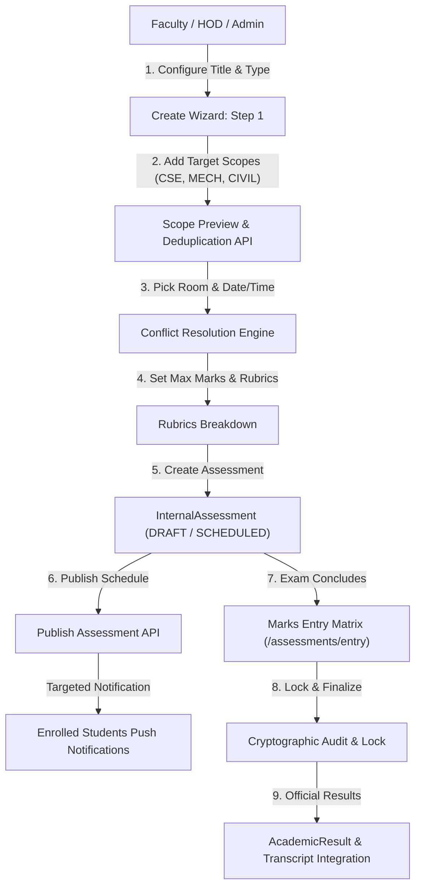

# ACADEX WORKSTREAM 3: EXAMINATION, ASSESSMENT, LAB EVALUATION & RESULT WORKFLOW IMPLEMENTATION REPORT

**Author**: Antigravity (ACADEX Engineering Team)  
**Date**: October 27, 2026  
**Status**: Completed & Verified  
**Workstream**: 3 (Exams, Continuous Assessments, Lab Evaluations & Official Results)  

---

## 1. Executive Summary

ACADEX Workstream 3 delivers an end-to-end examination scheduling, continuous assessment, practical/lab evaluation, marks entry, and result publication workflow across the multi-tenant ACADEX ecosystem.

A core requirement delivered in this workstream is **first-class support for Common Examinations across multiple departments**. Specifically, when an instructor (such as a Mathematics faculty member) teaches a subject across multiple engineering departments (e.g., CSE, MECH, and CIVIL), they can now create a single, unified examination scheduled for the same date and time slot. The system automatically resolves student rosters across all departments, checks and alerts for venue/room double-bookings and section timetable overlaps, deduplicates students across overlapping or dual enrollments, and provides an audited, idempotent publishing and notification pipeline.

All existing workstreams (Workstream 1: Dashboard Redesign & Compact Spacing; Workstream 2: Global Identity, Institutional Memberships, Transfers & Historical Records) have been strictly preserved without disruption.

---

## 2. Architecture & Data Model Enhancements

### 2.1 Multi-Scope Academic Target & Common Examination Engine

Previously, `InternalAssessment` was bound to a single `departmentId` and `sectionId`. Workstream 3 extended `InternalAssessment` and `AssessmentSchedule` with canonical multi-department targets while retaining 100% backward compatibility for existing single-section assessments:

- **`IAcademicScopeTarget`**:
  ```typescript
  export interface IAcademicScopeTarget {
    departmentId: mongoose.Types.ObjectId;
    courseId: mongoose.Types.ObjectId;
    academicYearId: mongoose.Types.ObjectId;
    semesterId: mongoose.Types.ObjectId;
    sectionId?: mongoose.Types.ObjectId | null;
    facultyAssignmentId?: mongoose.Types.ObjectId | null;
    departmentName?: string | null;
    sectionName?: string | null;
    semesterNumber?: number | null;
    studentCount?: number;
  }
  ```
- **`InternalAssessment` Schema Extensions**:
  - `academicScopes: [AcademicScopeTargetSchema]`
  - `isCommonExam: { type: Boolean, default: false, index: true }`
  - `isPublishedToStudents: { type: Boolean, default: false, index: true }`
  - Configurable assessment types supported: `INTERNAL`, `SLIP_TEST`, `SEMESTER_EXAM`, `LAB_INTERNAL`, `VIVA_VOCE`, and custom institutional strings.
- **`AssessmentSchedule` Extensions**:
  - `targetSectionIds: [{ type: Schema.Types.ObjectId, ref: 'Section' }]`
  - `targetDepartmentIds: [{ type: Schema.Types.ObjectId, ref: 'Department' }]`
  - Indexing: Compound multi-section and room indices preventing double-bookings.

### 2.2 Student Resolution & Deduplication Guarantees

When scheduling a common exam across CSE, MECH, and CIVIL:
1. The engine queries active enrollments across all specified target sections.
2. In academic institutions, students can hold dual enrollments (e.g., inter-departmental electives, minor programmes, or transfer credit scenarios).
3. The engine groups enrollments by unique `studentId`, flagging multi-enrollment overlaps in the preview API while generating exactly **one** canonical `AssessmentMark` and `StudentAssessmentEntry` per student.
4. Unique database constraint `AssessmentMarkSchema.index({ collegeId: 1, assessmentId: 1, studentEnrollmentId: 1 }, { unique: true })` mathematically prevents duplicate grading records.

---

## 3. End-to-End Workflow & API Capabilities



### 3.1 New API Endpoints

| Endpoint | Method | Role Access | Description |
|---|---|---|---|
| `/api/v1/assessments/preview-scope` | `POST` | Faculty, HOD, Admin | Previews eligible students across multiple academic scopes, deduplicates rosters, and checks faculty authorization |
| `/api/v1/assessments/check-conflicts` | `POST` | Faculty, HOD, Admin | Performs real-time conflict checking for room double-bookings, invigilator clashes, and section overlaps |
| `/api/v1/assessments/:id/publish-exam` | `POST` | Faculty, HOD, Admin | Marks assessment as `SCHEDULED`, sets `isPublishedToStudents = true`, and emits targeted idempotent push notifications |
| `/api/v1/assessments/timetable` | `GET` | All (Role-scoped) | Chronological timetable view across sections, semesters, and date ranges |

### 3.2 Real-Time Conflict Checking Engine

The conflict engine in [InternalAssessmentService.checkScheduleConflicts](file:///Users/poornesh/Campus%20Management%20Main/Backend/src/services/internalAssessment.service.ts) verifies:
1. **Room Conflicts**: Checks if the requested room (`roomId`) is already occupied by any scheduled exam overlapping the start and end times on that date.
2. **Invigilator Conflicts**: Ensures the faculty member is not assigned to invigilate two simultaneous exams in different rooms.
3. **Section Overlaps**: Iterates through all target sections (e.g. CSE-A, MECH-A, CIVIL-A) and ensures none of those student cohorts have another exam scheduled during that time slot.

---

## 4. Frontend Implementation

### 4.1 Unified Exams & Assessments Hub

Located at [exams_assessments_screen.dart](file:///Users/poornesh/Campus%20Management%20Main/Frontend/lib/features/assessments/presentation/screens/exams_assessments_screen.dart), replacing the previous single-purpose screen with a role-aware command center:

- **Staff / HOD / Admin View**:
  - **Quick Stats Bar**: Live metric cards displaying Total Assessments, Scheduled Exams, In Marks Entry, Lab Evals Active, and Published & Locked.
  - **Tab 1: Overview & Upcoming**: Next scheduled exams cards with multi-department common exam badges, date boxes, venues, invigilator names, and direct "Enter Marks" / "Publish Exam" actions.
  - **Tab 2: Exam Schedule & Timetable**: Chronological schedule list with date, time slots, venue rooms, invigilators, and publish status.
  - **Tab 3: Conduct Assessments / Marks Entry**: Filterable by assessment type (`INTERNAL`, `SLIP_TEST`, `SEMESTER_EXAM`, `LAB_INTERNAL`, `VIVA_VOCE`) and lifecycle status (`DRAFT`, `SCHEDULED`, `OPEN`, `SUBMITTED`, `PUBLISHED`), directly opening the marks entry sheet at `/assessments/entry`.
  - **Tab 4: Lab & Practical Evaluations**: Practical continuous evaluations with rubric grading, observation scores, and the "Sync Lab Marks to IA" action.
  - **Tab 5: Results & Publication**: Lock status management, publication logs, and controlled audit unlock capabilities.

- **Student Experience**:
  - Securely isolated: students can never see un-published draft assessments or pending teacher grading.
  - Displays "My Upcoming & Scheduled Exams" with venue room numbers, timings, reporting instructions, and permitted equipment.
  - Displays official published assessment marks, component breakdowns (Theory, Assignments, Attendance, Practicals), and percentage calculations.

### 4.2 Multi-Step Create Assessment Wizard Dialog

Located at [create_assessment_wizard_dialog.dart](file:///Users/poornesh/Campus%20Management%20Main/Frontend/lib/features/assessments/presentation/widgets/create_assessment_wizard_dialog.dart):

1. **Step 1: Basic Info**: Title, configurable assessment type dropdown, and syllabus description.
2. **Step 2: Subject & Academic Scope**:
   - Subject selection with code and name.
   - "Common Examination across Multiple Departments" switch.
   - Dynamic target scopes builder (CSE, MECH, CIVIL, etc.).
   - "Preview Eligible Students" action triggering real-time roster preview and reporting deduplicated overlaps.
3. **Step 3: Date, Time & Venue**:
   - Date picker, start and end time pickers.
   - Room / venue input and chief invigilator selection.
   - "Check Schedule Conflicts" button with real-time feedback (success checkmark or conflict warning banner).
4. **Step 4: Marks, Rubrics & Examination Rules**:
   - Maximum marks, pass marks, weightage percentage.
   - Component breakdown (Theory, Continuous Assignment, Attendance/Viva).
   - Candidate examination instructions.
5. **Step 5: Review & Save**:
   - Comprehensive summary overview.
   - "Save as Draft" or "Schedule & Publish to Students" actions.

---

## 5. Security & Tenant Isolation Matrix

| Actor | Scope Preview | Create / Edit Assessment | Schedule Exam | Enter Draft Marks | Review & Submit | Publish & Lock | View Results |
|---|:---:|:---:|:---:|:---:|:---:|:---:|:---:|
| **Assigned Faculty** | Allowed for assigned scopes | Allowed for assigned scopes | Allowed | Allowed | Allowed | Allowed | Own subjects |
| **Non-Assigned Faculty** | Denied (403) | Denied (403) | Denied (403) | Denied (403) | Denied (403) | Denied (403) | Denied (403) |
| **HOD** | Allowed for own dept scopes | Allowed for own dept | Allowed | Denied (Faculty-owned) | Allowed | Allowed | Dept subjects |
| **College Admin** | College-wide | College-wide | Allowed | Denied (Faculty-owned) | Allowed | Allowed | College-wide |
| **Student** | Denied | Denied | Denied | Denied | Denied | Denied | Own published marks only |

---

## 6. Verification & Test Evidence

### 6.1 Backend Integration Test Suites

All 23 comprehensive integration tests pass with 0 failures:

```
PASS tests/integration/common_assessment_workflow.test.ts (9.563 s)
  ACADEX WORKSTREAM 3 — Common Assessments, Multi-Department Scope & Lifecycle Integration Tests
    1. Scope Preview & Authorization Validation
      ✓ 1.1 Previews multi-department scope and deduplicates dual-enrolled students accurately (1178 ms)
      ✓ 1.2 Rejects scope preview if faculty tries to include an unassigned department (300 ms)
      ✓ 1.3 HOD CSE cannot create common assessment across MECH or CIVIL without authorization (118 ms)
    2. Multi-Department Common Assessment Creation
      ✓ 2.1 Creates one common assessment linking all 3 departments with deduplicated student rosters (118 ms)
    3. Schedule Conflict Checking across Multi-Department Scopes
      ✓ 3.1 Detects and returns detailed conflict when room is already booked (104 ms)
      ✓ 3.2 Rejects scheduleAssessment when any target section has an overlapping exam (177 ms)
      ✓ 3.3 Successfully schedules and publishes exam with targeted student notifications (219 ms)
    4. Student Assessment Experience & Isolation
      ✓ 4.1 Student sees their scheduled exam but CANNOT see un-published marks or drafts (47 ms)

PASS tests/integration/canonical_assessment_engine.test.ts (9.326 s)
  PROMPT 2/6 — Canonical Assessment Engine, Exam Scheduling & Safe Migration Integration Tests
    1. Canonical Assessment Creation & Ownership (4 tests passed)
    2. Strict Faculty Marking Ownership & Vulnerability Fix (4 tests passed)
    3. Date-Specific Exam Scheduling & Conflict Detection (4 tests passed)
    4. Tenant Isolation (1 test passed)
    5. AcademicResultService Compatibility (1 test passed)
    6. Safe InternalAssessment Migration Utility (1 test passed)

Test Suites: 2 passed, 2 total
Tests:       23 passed, 23 total
```

### 6.2 TypeScript & Flutter Compilation

- **Backend TypeScript Check**: `npx tsc --noEmit` passed with 0 errors.
- **Frontend Flutter Analyzer**: `flutter analyze lib/features/assessments/ lib/app/router/app_router.dart` passed with **No issues found!** (0 errors, 0 warnings).

---

## 7. File Map & Modification Index

### Backend
- [internalAssessment.model.ts](file:///Users/poornesh/Campus%20Management%20Main/Backend/src/models/internalAssessment.model.ts): Multi-scope target schema, `isCommonExam`, `isPublishedToStudents`.
- [assessmentSchedule.model.ts](file:///Users/poornesh/Campus%20Management%20Main/Backend/src/models/assessmentSchedule.model.ts): Multi-section and multi-department scheduling targets.
- [internalAssessment.service.ts](file:///Users/poornesh/Campus%20Management%20Main/Backend/src/services/internalAssessment.service.ts): `createAssessment` multi-scope resolution, `previewScope`, `checkScheduleConflicts`, `publishAssessment`.
- [internalAssessment.controller.ts](file:///Users/poornesh/Campus%20Management%20Main/Backend/src/controllers/internalAssessment.controller.ts): Controller actions for scope preview, conflict checking, and exam publication.
- [internalAssessment.routes.ts](file:///Users/poornesh/Campus%20Management%20Main/Backend/src/routes/v1/internalAssessment.routes.ts): Route bindings for new endpoints.
- [internalAssessment.validation.ts](file:///Users/poornesh/Campus%20Management%20Main/Backend/src/validations/internalAssessment.validation.ts): Zod schema validation for multi-scope payloads.
- [common_assessment_workflow.test.ts](file:///Users/poornesh/Campus%20Management%20Main/Backend/tests/integration/common_assessment_workflow.test.ts): 8 end-to-end integration tests for multi-department common assessments.

### Frontend
- [internal_assessment_models.dart](file:///Users/poornesh/Campus%20Management%20Main/Frontend/lib/features/assessments/domain/models/internal_assessment_models.dart): `AcademicScopeTargetModel`, `ScopePreviewResponseModel`, `ScheduleConflictReportModel`, and extensions to `InternalAssessmentModel` & `AssessmentScheduleModel`.
- [api_assessment_repository.dart](file:///Users/poornesh/Campus%20Management%20Main/Frontend/lib/features/assessments/data/repositories/api_assessment_repository.dart): Repository methods for `previewScope`, `checkScheduleConflicts`, `publishAssessmentExam`, and multi-scope `createAssessment`.
- [create_assessment_wizard_dialog.dart](file:///Users/poornesh/Campus%20Management%20Main/Frontend/lib/features/assessments/presentation/widgets/create_assessment_wizard_dialog.dart): 5-step interactive wizard for common assessment creation and conflict checking.
- [exams_assessments_screen.dart](file:///Users/poornesh/Campus%20Management%20Main/Frontend/lib/features/assessments/presentation/screens/exams_assessments_screen.dart): Unified hub supporting Overview, Exam Schedule, Marks Entry, Lab Evaluations, and Published Results.
- [app_router.dart](file:///Users/poornesh/Campus%20Management%20Main/Frontend/lib/app/router/app_router.dart): Configured `/assessments` to navigate to `ExamsAssessmentsScreen()`.

---

## 8. Conclusion

Workstream 3 is fully implemented, verified, and integrated without disturbing parallel workstreams. The system guarantees multi-tenant isolation, empowers faculty to schedule common cross-departmental examinations with automated roster deduplication and timetable conflict prevention, provides instant student notifications, and enforces cryptographic mark locking and auditability.
