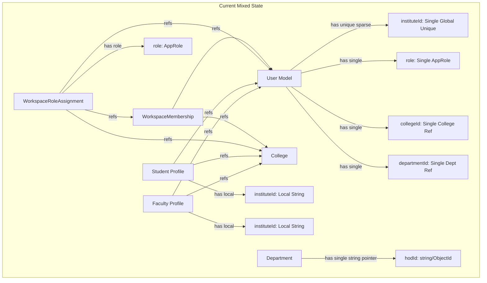
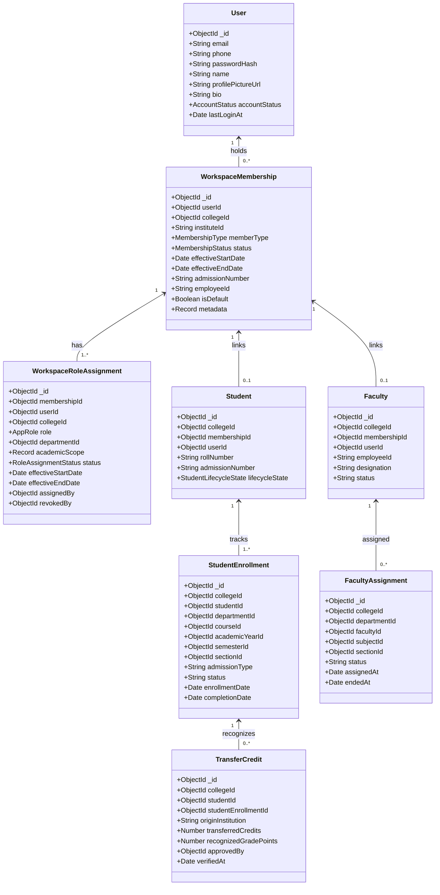
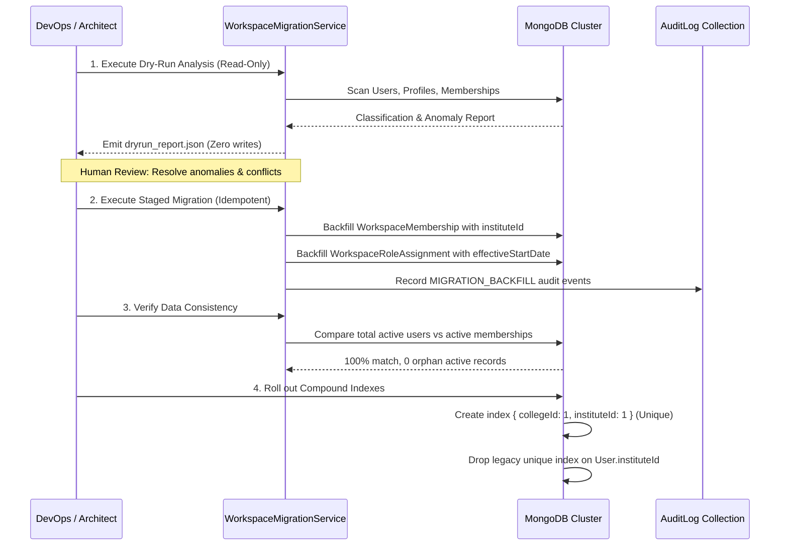

# ACADEX Global Identity, Multi-Institutional Identities & Academic History Architecture Audit

**Target Document:** `docs/reports/acadex_global_identity_architecture_audit.md`  
**Status:** Audit & Architecture Specification (Planning Phase — No Production Mutation)  
**Author:** Senior Flutter, Node.js, TypeScript, Express, MongoDB & Authentication Architect  
**Date:** 2026-10-27  

---

## Executive Summary

The ACADEX Campus Management Platform is evolving from a single-institution-bound identity system into a multi-tenant, federated academic ecosystem. In this ecosystem, **a single human user possesses one stable global account, can hold multiple distinct institutional memberships across colleges (each with its own institutional PIN Number, roll number, or staff ID), can exercise different roles in different colleges simultaneously (e.g. HOD at College A and Faculty at College B), and preserves their permanent academic and administrative audit history without data loss, impersonation, or cross-tenant leakage.**

This comprehensive audit evaluates the existing codebase, identifies critical architectural bottlenecks, analyzes six complex real-world operational scenarios, establishes rigorous data ownership and historical access matrices, defines security and tenant-isolation boundaries, and outlines a safe, non-destructive phased roadmap for future implementation (Prompts 2, 3, and 4).

---

## 1. Current Architecture and Relevant File Paths

The ACADEX application consists of a Node.js/TypeScript Express backend backed by MongoDB (Mongoose ODM) and a Flutter cross-platform client using Riverpod state management.

### 1.1 Backend Core Modules & Schema Definitions

| Module / Layer | File Path | Current Role in Identity / Context |
| :--- | :--- | :--- |
| **Global User Model** | [`user.model.ts`](file:///Users/poornesh/Campus%20Management%20Main/Backend/src/models/user.model.ts) | Stores login credentials, password hash, and global profile, but currently couples a single `instituteId`, single `role`, single `collegeId`, single `departmentId`, and legacy academic caches (`courseId`, `sectionId`, `semesterId`). |
| **Workspace Membership** | [`workspaceMembership.model.ts`](file:///Users/poornesh/Campus%20Management%20Main/Backend/src/models/workspaceMembership.model.ts) | Intermediate link between User and College (`userId`, `collegeId`, `status`, `isDefault`, `joinedAt`, `suspendedAt`, `revokedAt`). **Missing:** institutional PIN (`instituteId`), staff/student ID, admission metadata, and effective date ranges. |
| **Workspace Role Assignment** | [`workspaceRoleAssignment.model.ts`](file:///Users/poornesh/Campus%20Management%20Main/Backend/src/models/workspaceRoleAssignment.model.ts) | Associates membership with specific role and optional department (`membershipId`, `userId`, `collegeId`, `role`, `departmentId`, `status`, `assignedAt`, `revokedAt`). |
| **Institutional Student Profile** | [`student.model.ts`](file:///Users/poornesh/Campus%20Management%20Main/Backend/src/models/student.model.ts) | Stores tenant-scoped student record (`collegeId`, `departmentId`, `userId`, `instituteId`, `rollNumber`, `admissionNumber`, `lifecycleState`). |
| **Institutional Faculty Profile** | [`faculty.model.ts`](file:///Users/poornesh/Campus%20Management%20Main/Backend/src/models/faculty.model.ts) | Stores tenant-scoped faculty profile (`collegeId`, `departmentId`, `userId`, `instituteId`, `employeeId`, `designation`, `status`). |
| **Tenant / College Model** | [`college.model.ts`](file:///Users/poornesh/Campus%20Management%20Main/Backend/src/models/college.model.ts) | Canonical institution document (`name`, `code`, `status`, `isActive`, `timezone`). |
| **Department Model** | [`department.model.ts`](file:///Users/poornesh/Campus%20Management%20Main/Backend/src/models/department.model.ts) | Department document (`collegeId`, `code`, `name`, `hodId`). Notice `hodId` is a single string/ObjectId pointer without tenure history. |
| **Academic Hierarchy Models** | [`course.model.ts`](file:///Users/poornesh/Campus%20Management%20Main/Backend/src/models/course.model.ts), [`semester.model.ts`](file:///Users/poornesh/Campus%20Management%20Main/Backend/src/models/semester.model.ts), [`section.model.ts`](file:///Users/poornesh/Campus%20Management%20Main/Backend/src/models/section.model.ts), [`subject.model.ts`](file:///Users/poornesh/Campus%20Management%20Main/Backend/src/models/subject.model.ts) | Academic structure containers defining curricula, stages, and class sections. |
| **Academic Enrolment** | [`studentEnrollment.model.ts`](file:///Users/poornesh/Campus%20Management%20Main/Backend/src/models/studentEnrollment.model.ts) | Multi-period student academic placement (`collegeId`, `studentId`, `departmentId`, `courseId`, `academicYearId`, `semesterId`, `sectionId`, `cohort`, `status`). |
| **Teaching Assignment** | [`facultyAssignment.model.ts`](file:///Users/poornesh/Campus%20Management%20Main/Backend/src/models/facultyAssignment.model.ts) | Authoritative teaching assignment (`collegeId`, `departmentId`, `facultyId`, `facultyName`, `subjectId`, `courseId`, `semesterId`, `sectionId`, `academicYearId`, `status: active\|archived`, `assignedAt`, `endedAt`). |
| **Invitations & Activation** | [`invitation.model.ts`](file:///Users/poornesh/Campus%20Management%20Main/Backend/src/models/invitation.model.ts) | Pre-provisioned invitation codes (`userId`, `collegeId`, `departmentId`, `role`, `codeHash`, `status`, `expiresAt`). |
| **Authentication Session** | [`authSession.model.ts`](file:///Users/poornesh/Campus%20Management%20Main/Backend/src/models/authSession.model.ts) | Server-side session store validating refresh tokens, device info, expiry, and revocation (`sessionId`, `userId`, `refreshTokenHash`, `revokedAt`). |
| **System Audit Log** | [`auditLog.model.ts`](file:///Users/poornesh/Campus%20Management%20Main/Backend/src/models/auditLog.model.ts) | Canonical audit log (`collegeId`, `workspaceMembershipId`, `actorUserId`, `actorRole`, `action`, `entityType`, `entityId`, `previousValue`, `newValue`). |
| **Attendance Models** | [`attendanceSession.model.ts`](file:///Users/poornesh/Campus%20Management%20Main/Backend/src/models/attendanceSession.model.ts), [`attendanceRecord.model.ts`](file:///Users/poornesh/Campus%20Management%20Main/Backend/src/models/attendanceRecord.model.ts) | Records classroom attendance sessions (`facultyId` refs Faculty, `studentId` refs Student, `modifiedBy` string). |
| **Assignment Models** | [`assignment.model.ts`](file:///Users/poornesh/Campus%20Management%20Main/Backend/src/models/assignment.model.ts), [`assignmentSubmission.model.ts`](file:///Users/poornesh/Campus%20Management%20Main/Backend/src/models/assignmentSubmission.model.ts) | Homework and tasks (`facultyId` refs User, `facultyAssignmentId` refs FacultyAssignment, `studentId` refs Student, `studentUserId` refs User). |
| **Assessments & Marks** | [`internalAssessment.model.ts`](file:///Users/poornesh/Campus%20Management%20Main/Backend/src/models/internalAssessment.model.ts), [`assessmentMark.model.ts`](file:///Users/poornesh/Campus%20Management%20Main/Backend/src/models/assessmentMark.model.ts) | Internal tests, schedules, and student marks (`facultyAssignmentId`, `studentEnrollmentId`, `studentId` refs Student, `lockedBy`/`performedBy` refs User). |
| **Academic Records & Results** | [`academicRecord.model.ts`](file:///Users/poornesh/Campus%20Management%20Main/Backend/src/models/academicRecord.model.ts), [`academicResult.model.ts`](file:///Users/poornesh/Campus%20Management%20Main/Backend/src/models/academicResult.model.ts) | Official term records, GPAs, and publication snapshots (`studentId`, `studentEnrollmentId`, `publicationSnapshots[].publishedBy` refs User). |
| **Timetable & Substitution** | [`timetable.model.ts`](file:///Users/poornesh/Campus%20Management%20Main/Backend/src/models/timetable.model.ts), [`teacherSubstitution.model.ts`](file:///Users/poornesh/Campus%20Management%20Main/Backend/src/models/teacherSubstitution.model.ts) | Timetable schedules (`entries[].facultyId` refs Faculty) and temporary substitutions (`originalFacultyId`, `substituteFacultyId` ref Faculty). |
| **Resource Notes** | [`note.model.ts`](file:///Users/poornesh/Campus%20Management%20Main/Backend/src/models/note.model.ts) | Educational materials (`facultyId` refs Faculty, `authorUserId` refs User). |
| **Requests Engine** | [`request.model.ts`](file:///Users/poornesh/Campus%20Management%20Main/Backend/src/models/request.model.ts) | Formal student/faculty requests (`requesterUserId`, `targetUserId`, `respondedBy` ref User). |

### 1.2 Backend Middleware, Services & Utilities

| Service / Utility | File Path | Functionality & Critical Behaviors |
| :--- | :--- | :--- |
| **Authentication Middleware** | [`auth.middleware.ts`](file:///Users/poornesh/Campus%20Management%20Main/Backend/src/middleware/auth.middleware.ts) | Authenticates Bearer tokens, validates sessions in `AuthSession`, loads `User`, checks `X-Workspace-Id` vs token claims, loads active `WorkspaceMembership` & `WorkspaceRoleAssignment`, sets `req.user`, `req.collegeId`, `req.tenant`, `req.workspace`. |
| **Tenant Middleware** | [`tenant.middleware.ts`](file:///Users/poornesh/Campus%20Management%20Main/Backend/src/middleware/tenant.middleware.ts) | Enforces tenant-scoping for non-super-admin routes, guarding against cross-tenant data requests. |
| **Authentication Service** | [`auth.service.ts`](file:///Users/poornesh/Campus%20Management%20Main/Backend/src/services/auth.service.ts) | Handles login by email, phone, or PIN (`instituteId`), checks password, mints JWT access and refresh tokens. |
| **Workspace Controller** | [`workspace.controller.ts`](file:///Users/poornesh/Campus%20Management%20Main/Backend/src/controllers/workspace.controller.ts) | Serves `GET /my-memberships` and `POST /switch`. Authoritatively issues refreshed tokens for target workspaces. |
| **Invitation & Activation Service** | [`invitation.service.ts`](file:///Users/poornesh/Campus%20Management%20Main/Backend/src/services/invitation.service.ts), [`activation.service.ts`](file:///Users/poornesh/Campus%20Management%20Main/Backend/src/services/activation.service.ts) | Multi-step activation: code validation, channel OTP verification, password setup, and idempotent membership creation. |
| **Teaching Authorization** | [`teachingAuthorization.service.ts`](file:///Users/poornesh/Campus%20Management%20Main/Backend/src/services/teachingAuthorization.service.ts) | Verifies faculty ownership of assignments and teaching contexts using canonical IDs (`userId`, `facultyId`). |
| **Workspace Migration Engine** | [`workspaceMigration.service.ts`](file:///Users/poornesh/Campus%20Management%20Main/Backend/src/services/migration/workspaceMigration.service.ts) | Existing dry-run and migration utility classifying legacy accounts into `WorkspaceMembership` and `WorkspaceRoleAssignment`. |
| **Identifier Normalization** | [`identifier.ts`](file:///Users/poornesh/Campus%20Management%20Main/Backend/src/utils/identifier.ts) | Detects email, phone, or PIN Number (`instituteId`) and formats standard uppercase identifiers. |
| **Token Minting & Verification** | [`token.ts`](file:///Users/poornesh/Campus%20Management%20Main/Backend/src/utils/token.ts) | Signs and verifies JWT tokens containing `userId`, `instituteId`, `role`, `collegeId`, `departmentId`, `sessionId`. |

### 1.3 Frontend Architecture & Workspace Components

| Component / Layer | File Path | Architectural Function |
| :--- | :--- | :--- |
| **User Domain Model** | [`user_model.dart`](file:///Users/poornesh/Campus%20Management%20Main/Frontend/lib/features/auth/domain/models/user_model.dart) | Represents client-side user; currently mirrors backend `UserModel` with single `instituteId`, single `role`, single `collegeId`. |
| **Workspace Domain Model** | [`workspace_model.dart`](file:///Users/poornesh/Campus%20Management%20Main/Frontend/lib/features/auth/domain/models/workspace_model.dart) | Represents `WorkspaceMembershipModel` (`id`, `collegeId`, `collegeName`, `collegeCode`, `status`, `roles`, `primaryRole`, `departments`). |
| **Workspace Providers** | [`workspace_providers.dart`](file:///Users/poornesh/Campus%20Management%20Main/Frontend/lib/features/auth/presentation/providers/workspace_providers.dart) | Riverpod providers: `userWorkspacesProvider`, `activeWorkspaceIdProvider`, `activeWorkspaceProvider`, `workspaceGenerationProvider`, `WorkspaceSwitchController`. Invalidates all feature providers on switch. |
| **Workspace Selector UI** | [`workspace_selector_dialog.dart`](file:///Users/poornesh/Campus%20Management%20Main/Frontend/lib/features/auth/presentation/widgets/workspace_selector_dialog.dart) | Modal dialog displaying authorized workspaces and triggering seamless workspace switches. |
| **Activation Screen** | [`activation_screen.dart`](file:///Users/poornesh/Campus%20Management%20Main/Frontend/lib/features/auth/presentation/screens/activation_screen.dart) | Multi-step activation flow: code validation -> masked channel selection -> OTP verification -> password setup / existing user confirmation. |
| **Login Screen** | [`login_screen.dart`](file:///Users/poornesh/Campus%20Management%20Main/Frontend/lib/features/auth/presentation/screens/login_screen.dart) | Single identifier input (Email, Phone, or PIN) + Password with role-based routing. |
| **Navigation Headers** | [`acadex_app_bar.dart`](file:///Users/poornesh/Campus%20Management%20Main/Frontend/lib/features/dashboard/presentation/widgets/acadex_app_bar.dart), [`acadex_drawer.dart`](file:///Users/poornesh/Campus%20Management%20Main/Frontend/lib/features/dashboard/presentation/widgets/acadex_drawer.dart) | Displays active workspace badge (`collegeCode` or `collegeName`) and triggers workspace switcher dialog. |

---

## 2. Existing Identity, Membership, and Role Relationships

A forensic analysis of the schema and codebase reveals a **hybrid state**: while intermediate models (`WorkspaceMembership` and `WorkspaceRoleAssignment`) were introduced in previous iterations, core authentication, invitation, and data tracking layers still heavily depend on legacy single-tenant fields residing directly on the `User` model.



### 2.1 The Global Identity Disconnect
1. **Global Uniqueness Constraint on PIN Number:**  
   In [`user.model.ts:38-44`](file:///Users/poornesh/Campus%20Management%20Main/Backend/src/models/user.model.ts#L38-L44):
   ```typescript
   instituteId: {
     type: String,
     unique: true,
     sparse: true,
     uppercase: true,
     trim: true,
   }
   ```
   Because `User.instituteId` is indexed as globally unique across the entire `users` collection, **a single user cannot have different institutional PIN numbers in College A and College B.** Furthermore, two completely distinct users across different colleges cannot share the same PIN format (e.g. `2024-CSE-001` or `ADMIN-001`).

2. **Single-Role and Single-Tenant Locks on User:**  
   `User` stores single scalar fields: `collegeId`, `departmentId`, `role`, `courseId`, `sectionId`, `semesterId`. When an existing user receives a new membership in College B via [`invitation.service.ts`](file:///Users/poornesh/Campus%20Management%20Main/Backend/src/services/invitation.service.ts), their `User.collegeId` and `User.role` are NOT updated to avoid breaking College A, but standard login [`auth.service.ts:133-146`](file:///Users/poornesh/Campus%20Management%20Main/Backend/src/services/auth.service.ts#L133-L146) mints access tokens directly from `user.role` and `user.collegeId`!

3. **Workspace Switching Re-uses Global PIN:**  
   In [`workspace.controller.ts:298-308`](file:///Users/poornesh/Campus%20Management%20Main/Backend/src/controllers/workspace.controller.ts#L298-L308):
   ```typescript
   const accessToken = signAccessToken({
     userId: dbUser.id,
     instituteId: dbUser.instituteId, // <-- Overwritten with College A PIN even in College B!
     email: dbUser.email,
     phone: dbUser.phone,
     name: dbUser.name,
     role: primaryRole,
     collegeId: targetCollege.id,
     departmentId: authorizedDepartmentIds[0],
     sessionId: req.user?.sessionId,
   });
   ```
   When switching from College A to College B, the user receives an access token bound to College B, but with College A's `instituteId` baked into the token claims!

4. **Compensating Rollback Catastrophe in Profile Provisioning:**  
   In [`student.service.ts:204-208`](file:///Users/poornesh/Campus%20Management%20Main/Backend/src/services/student.service.ts#L204-L208) and [`faculty.service.ts:151-155`](file:///Users/poornesh/Campus%20Management%20Main/Backend/src/services/faculty.service.ts#L151-L155):
   ```typescript
   } catch (err: any) {
     // Compensating Rollback: Remove User and Invitation to prevent orphan states
     await Promise.all([
       User.findByIdAndDelete(user._id), // <-- DELETES EXISTING GLOBAL USER ACCOUNT!
       Invitation.findByIdAndDelete(invitationResult.invitation.id),
     ]);
     ...
   }
   ```
   If an existing user from College A is provisioned as a student or faculty in College B and profile creation fails (e.g. duplicate roll number or validation error), the error handler executes `User.findByIdAndDelete(user._id)`. **This permanently destroys the global user account, severing their access to College A!**

5. **Inconsistent Attribution References Across Records:**  
   Academic models refer to actors and profiles inconsistently:
   - `attendanceSession.model.ts`: `facultyId` refers to `Faculty` (the institutional document).
   - `assignment.model.ts`: `facultyId` refers to `User` (the global user document).
   - `assignmentSubmission.model.ts`: stores both `studentId` (ref: `Student`) and `studentUserId` (ref: `User`).
   - `assessmentMark.model.ts`: stores `studentId` (ref: `Student`), `studentEnrollmentId` (ref: `StudentEnrollment`), and `performedBy` (ref: `User`).
   - `internalAssessment.model.ts`: stores `facultyAssignmentId` (ref: `FacultyAssignment`), `facultyId` (ref: `Faculty`), and `auditLog[].performedBy` (ref: `User`).

---

## 3. Scenario-by-Scenario Assessment

### Scenario A: Faculty Transfer
> **Context:** Teacher X transfers from College A to College B. Teacher Y joins College A and takes over Python.
> - Teacher X retains their global account and historical College A identity.
> - College B receives a separate institutional membership and relevant role assignments.
> - Teacher Y receives a new authorized teaching assignment at College A.
> - Old attendance, evaluations, assignments, and audit records retain their original attribution.
> - Teacher Y receives authorized access to relevant historical course information without inheriting Teacher X's identity or unrestricted account access.

#### Current Behavior & Failure Modes
1. `transferFacultyDepartment` in [`faculty.service.ts:493`](file:///Users/poornesh/Campus%20Management%20Main/Backend/src/services/faculty.service.ts#L493) explicitly throws `ApiError.forbidden('Cannot transfer faculty to a department belonging to another college')`. There is zero support for cross-college movement.
2. If College B invites Teacher X using their verified email:
   - An invitation is created.
   - However, College B cannot assign Teacher X a new PIN number because `User.instituteId` is locked to College A's PIN.
3. If Teacher X's `FacultyAssignment` for Python at College A is deleted via [`academic.service.ts:2528`](file:///Users/poornesh/Campus%20Management%20Main/Backend/src/services/academic.service.ts#L2528), it is hard-deleted if no published timetable or attendance session is found. If archived, Teacher Y is assigned a new `FacultyAssignment`.
4. **Visibility Failure:** When Teacher Y logs into College A and calls `GET /attendance/sessions`, [`attendance.service.ts:932`](file:///Users/poornesh/Campus%20Management%20Main/Backend/src/services/attendance.service.ts#L932) executes:
   ```typescript
   if (requester.role === AppRole.FACULTY) {
     const myFaculty = await this.resolveFacultyProfile(requester);
     filter.facultyId = myFaculty._id; // Teacher Y's faculty profile
   }
   ```
   Teacher Y cannot see ANY of the attendance sessions conducted by Teacher X for Python earlier in the term!
5. **Assignment Handover Failure:** When Teacher Y calls `GET /assignments`, [`assignment.service.ts:427`](file:///Users/poornesh/Campus%20Management%20Main/Backend/src/services/assignment.service.ts#L427) filters strictly on `filter.facultyId = new Types.ObjectId(user.id)`. Teacher Y cannot see homework previously given by Teacher X for the class they now teach.

#### Minimum Safe Changes
- **Separate Membership for College B:** Teacher X maintains a `WorkspaceMembership` at College A (status transitioned to `INACTIVE` or `TRANSFERRED`, with `effectiveEndDate`) and receives an `ACTIVE` `WorkspaceMembership` at College B with a distinct College B `instituteId` (PIN).
- **Separate Faculty Profile at College B:** Teacher X has a `Faculty` profile in College A (preserving past teaching records) and a distinct `Faculty` profile in College B.
- **Teaching Assignment Handover:** Teacher X's `FacultyAssignment` for Python at College A is marked `ended` (`status: 'ended'`, `endedAt: new Date()`). Teacher Y receives a new `FacultyAssignment` (`status: 'active'`, `assignedAt: new Date()`).
- **Authorized Course Scope Querying:** Teacher Y's read queries for classroom materials, attendance summaries, and past assignments query by `subjectId` + `sectionId` within College A, instead of filtering solely by their own `facultyId`.
- **Historical Attribution Preservation:** Existing `AttendanceSession`, `Assignment`, and `AssessmentMark` documents retain `facultyId: TeacherX_FacultyId` and `actorUserId: TeacherX_UserId`. Teacher Y's new actions are attributed to Teacher Y.

---

### Scenario B: HOD Replacement
> **Context:** The Computer Science HOD leaves College A and a new HOD joins.
> - End the previous HOD appointment.
> - Create the new HOD appointment with effective dates.
> - Preserve the department's historical data and previous approvals.
> - Give the new HOD authorized access to departmental history.
> - Prevent the new HOD from impersonating the former HOD or silently editing their historical actions.

#### Current Behavior & Failure Modes
1. In [`department.model.ts:32`](file:///Users/poornesh/Campus%20Management%20Main/Backend/src/models/department.model.ts#L32), the HOD is tracked via a single unversioned scalar: `hodId: { type: String, default: null }`.
2. When a new HOD is provisioned or assigned via [`hod.service.ts:517`](file:///Users/poornesh/Campus%20Management%20Main/Backend/src/services/hod.service.ts#L517):
   ```typescript
   targetDept.hodId = user._id.toString();
   await targetDept.save();
   ```
   The previous HOD pointer is completely erased. The system retains no record of who served as HOD, when their tenure started, or when it ended.
3. If an audit log or approval requires looking up the HOD of Computer Science for a date six months ago, querying `Department.hodId` returns the *current* HOD, misattributing past approvals.

#### Minimum Safe Changes
- **HOD Tenure via WorkspaceRoleAssignment:** Department HOD assignments must be represented as effective-dated records in `WorkspaceRoleAssignment`:
  - Former HOD: `role: 'HOD'`, `departmentId: CS_Dept_Id`, `status: 'INACTIVE'`, `effectiveStartDate: Date`, `effectiveEndDate: Date`, `statusReason: 'RESIGNED_OR_ROTATED'`.
  - New HOD: `role: 'HOD'`, `departmentId: CS_Dept_Id`, `status: 'ACTIVE'`, `effectiveStartDate: Date`, `effectiveEndDate: null`.
- **Preserved Departmental History:** Historical approvals (calendar events, internal assessment locks, student requests) preserve `performedBy: FormerHOD_UserId`.
- **Scoped Operational Access:** The new HOD gains read access to all departmental history and operational write access to pending/future items. They cannot modify historical approvals signed by the former HOD.

---

### Scenario C: One Person, Multiple Workspaces
> **Context:** The same person is an HOD at College A and Faculty at College B.
> - One global account.
> - Separate institutional memberships and PIN Numbers where required.
> - Different role assignments and academic scopes.
> - Correct dashboard and permissions for the selected workspace.
> - No cross-college data leakage when switching workspaces.

#### Current Behavior & Failure Modes
1. The global `User` document stores only ONE `role`, ONE `collegeId`, ONE `departmentId`, and ONE `instituteId`.
2. If this user logs in with their global credentials, [`auth.service.ts:133-146`](file:///Users/poornesh/Campus%20Management%20Main/Backend/src/services/auth.service.ts#L133-L146) mints a token using whichever `role` and `collegeId` are saved on the `User` document.
3. When the user switches to College B via [`workspace.controller.ts:300`](file:///Users/poornesh/Campus%20Management%20Main/Backend/src/controllers/workspace.controller.ts#L300):
   - The backend looks up active role assignments for College B and detects `FACULTY`.
   - However, the access token is minted with `instituteId: dbUser.instituteId`, which is College A's HOD PIN Number!
   - College B's faculty operations that display or log the PIN number display College A's PIN!
4. If client-side or backend fallbacks read `user.departmentId`, they read College A's department while operating inside College B, risking cross-tenant corruption.

#### Minimum Safe Changes
- **Decouple Institutional PIN to Membership:** Move institutional PIN Number (`instituteId`) to `WorkspaceMembership`.
  - Membership A (College A): `instituteId: 'HOD-CSE-001'`, `status: 'ACTIVE'`.
  - Membership B (College B): `instituteId: 'FAC-MATH-042'`, `status: 'ACTIVE'`.
- **Workspace-Scoped Token Minting:** The access token must encode:
  - `userId`: Global user ID.
  - `collegeId`: Target workspace ID.
  - `workspaceMembershipId`: Active membership ID.
  - `instituteId`: Membership A's PIN when in College A; Membership B's PIN when in College B.
  - `role`: `HOD` in College A; `FACULTY` in College B.
  - `departmentId`: College A CS Dept in College A; College B Math Dept in College B.
- **Tenant Isolation Enforcement:** The server rejects any request where `req.headers['x-workspace-id']` does not match the active token's `collegeId`. Every database query enforces `{ collegeId: req.collegeId }`.

---

### Scenario D: Student Transfer
> **Context:** A student leaves College A and joins College B.
> - Preserve the College A student identity and historical records.
> - Create a separate College B student identity.
> - Define membership closure, transfer status, and enrollment dates.
> - Explain how verified transcripts and approved transfer credits can be shared without merging the colleges' academic records.
> - Prevent automatic account merging based only on matching names.

#### Current Behavior & Failure Modes
1. Intra-college department transfer exists ([`student.service.ts:772`](file:///Users/poornesh/Campus%20Management%20Main/Backend/src/services/student.service.ts#L772)), but cross-college transfer is explicitly blocked ([`student.service.ts:798`](file:///Users/poornesh/Campus%20Management%20Main/Backend/src/services/student.service.ts#L798)).
2. If College B attempts to admit the student:
   - If they invite them via email, [`invitation.service.ts:348-356`](file:///Users/poornesh/Campus%20Management%20Main/Backend/src/services/invitation.service.ts#L348-L356) finds the existing user.
   - But [`student.service.ts:186`](file:///Users/poornesh/Campus%20Management%20Main/Backend/src/services/student.service.ts#L186) attempts to create a `Student` document using `instituteId: user.instituteId`. If College B has a different roll number or PIN, it either overwrites or conflicts with `User.instituteId`.
3. If profile creation fails, the compensating rollback deletes the global `User` document, destroying College A records.
4. There is no transfer credit or transcript model. Transferring academic history would mean either copying records or giving College B direct access to College A's database collection, violating tenant isolation.

#### Minimum Safe Changes
- **College A Closure:** College A membership transitioned:
  - `WorkspaceMembership` at College A: `status: 'TRANSFERRED'`, `effectiveEndDate: Date`.
  - `StudentEnrollment` at College A: `status: 'transferred'`, `completionDate: Date`.
  - `Student` profile at College A remains intact, preserving all historical attendance, internal assessment marks, and exam results.
- **College B Admission:** College B creates a new `WorkspaceMembership`:
  - Bound to the same global `userId`.
  - Distinct `instituteId` (College B Roll Number / PIN).
  - New `Student` profile with `collegeId: CollegeB_Id`.
  - New `StudentEnrollment` starting at the admitted stage/semester.
- **Verified Transfer Credits via Explicit Model:** Instead of merging raw database records, College B records approved transfer credits via a `TransferCredit` model:
  - `collegeId: CollegeB_Id`
  - `studentId: CollegeB_Student_Id`
  - `originInstitutionName: 'College of Engineering A'`
  - `transferredCredits: 42`
  - `approvedBy: CollegeB_Admin_Id`
  - `verificationDocumentUrl: '...'`
- **Strict Verification (No Name Merging):** No automatic linking based on student name. Linking requires verified global authentication (OTP sent to verified email/phone or authenticated invite acceptance).

---

### Scenario E: Direct Second-Year Admission (Lateral Entry)
> **Context:** A student joins directly in the second year or enters during a later admission phase.
> - Support an initial enrollment in the correct academic year and semester.
> - Preserve verified prior qualifications and transfer credits where applicable.
> - Do not fabricate earlier attendance, marks, or local enrollments.
> - Ensure current timetable, assignments, attendance, and academic scope work normally.

#### Current Behavior & Failure Modes
1. In [`academic.service.ts:1180`](file:///Users/poornesh/Campus%20Management%20Main/Backend/src/services/academic.service.ts#L1180), `StudentEnrollment.create` allows creating an initial enrollment for Semester 3.
2. However, when [`academicResult.service.ts:405-434`](file:///Users/poornesh/Campus%20Management%20Main/Backend/src/services/academicResult.service.ts#L405-L434) computes CGPA:
   ```typescript
   if (ruleConfig.cgpaPolicy?.enabled) {
     const priorResults = await AcademicResult.find({
       collegeId,
       studentId,
       courseId,
       status: { $in: [ResultLifecycleStatus.FINALIZED, ResultLifecycleStatus.PUBLISHED] },
       semesterId: { $ne: semesterId },
     });
     ...
     cumulativeWeightedPoints += ...
     cumulativeCredits += ...
     cgpa = Math.round((cumulativeWeightedPoints / cumulativeCredits) * 100) / 100;
   }
   ```
   Because Semesters 1 and 2 do not exist for this student in College A, the system either:
   - Calculates CGPA dividing by only Semester 3 credits (distorting aggregate graduation eligibility).
   - Or flags an anomaly that previous semesters are missing.
3. Some legacy reports assume Semester 1 and 2 records must exist, leading administrators to create "dummy" or "fabricated" attendance sessions and zero marks.

#### Minimum Safe Changes
- **Lateral Entry Placement Flag:**
  - `Student` and `StudentEnrollment` store `admissionType: 'LATERAL_ENTRY' | 'REGULAR'`, `entryAcademicStage: '2nd Year'`, `entrySemesterNumber: 3`.
  - No dummy attendance sessions or zero marks are fabricated for Semesters 1 and 2.
- **Prior Qualification & Credit Recognition:**
  - A `PriorQualification` record documents the student's prior diploma or qualifying examination (e.g. State Technical Board Diploma, 88.4%, 40 credits recognized).
- **Result Engine Calibration:**
  - `AcademicResultService` checks `admissionType`. If `LATERAL_ENTRY`, CGPA calculations incorporate recognized transfer grade points or calculate CGPA strictly across enrolled terms (Semesters 3 through 8) according to the college's configured academic regulation policy.

---

### Scenario F: Faculty or Role Change within a College
> **Context:** A faculty member becomes HOD, changes department, or receives a different teaching assignment.
> - Preserve the global account.
> - End or update the relevant effective-dated assignments.
> - Create the new authorized assignment.
> - Preserve historical responsibilities and audit attribution.
> - Avoid accidentally granting access to the previous department or unrelated classes.

#### Current Behavior & Failure Modes
1. When a faculty member becomes an HOD via [`hod.service.ts:506-520`](file:///Users/poornesh/Campus%20Management%20Main/Backend/src/services/hod.service.ts#L506-L520), the backend updates `user.role = 'HOD'` and sets `department.hodId = user._id`.
2. However, the user's `Faculty` profile in [`faculty.model.ts`](file:///Users/poornesh/Campus%20Management%20Main/Backend/src/models/faculty.model.ts) and previous `FacultyAssignment` records in the former department remain in an indeterminate state.
3. When the faculty member transfers department via [`faculty.service.ts:467`](file:///Users/poornesh/Campus%20Management%20Main/Backend/src/services/faculty.service.ts#L467):
   ```typescript
   faculty.departmentId = targetDept._id;
   await faculty.save();
   ```
   Active `FacultyAssignment` records in the old department are NOT terminated or archived. The faculty member might continue to appear on the old department's attendance rosters and timetables.

#### Minimum Safe Changes
- **Effective-Dated Role Assignment:**
  - The faculty member's existing `WorkspaceRoleAssignment` (`role: 'FACULTY'`) is either retained (if HODs continue teaching) or retired (`status: 'INACTIVE'`, `revokedAt: new Date()`).
  - A new `WorkspaceRoleAssignment` (`role: 'HOD'`, `departmentId: targetDept._id`, `status: 'ACTIVE'`) is created.
- **Teaching Assignment Lifecycle:**
  - When changing departments, active `FacultyAssignment` records in the old department are cleanly archived (`status: 'archived'`, `endedAt: new Date()`).
  - Timetable drafts pull the ended assignments, while published timetables and historical attendance sessions preserve attribution to that faculty member.
- **Historical Attribution:** Past audit entries, signed attendance sessions, and graded assignments maintain the actor role as `FACULTY` at the timestamp of execution. New approvals show actor role `HOD`.

---

## 4. Recommended Target Data Model and Relationships

To satisfy all requirements safely with the **smallest possible extension** of the existing ACADEX schema, we decouple institutional identity and academic context from `User`, elevating `WorkspaceMembership` and `WorkspaceRoleAssignment` as the authoritative anchors.



### 4.1 Schema Definitions & Indexes

#### 1. Global User (`User`)
- **Purpose:** Pure authentication and universal human identity.
- **Fields:**
  - `_id`: Stable ObjectId.
  - `email`: String (lowercase, trimmed, unique, sparse).
  - `phone`: String (E.164, unique, sparse).
  - `passwordHash`: String (Argon2id/bcrypt).
  - `name`: String (Universal human display name).
  - `profilePictureUrl`: String.
  - `bio`: String.
  - `accountStatus`: `'ACTIVE' | 'PENDING_ACTIVATION' | 'SUSPENDED' | 'DEACTIVATED'`.
  - `lastLoginAt`: Date.
  - *Deprecated compatibility getters:* `collegeId`, `departmentId`, `role`, `instituteId` (delegated to default active membership during transition).

#### 2. Institutional Membership (`WorkspaceMembership`)
- **Purpose:** Represents the person's legal or academic standing within a specific college.
- **Fields to Add/Extend:**
  - `instituteId`: String (uppercase, trimmed, indexable) — **The Institutional PIN Number / ID** (e.g. `24CSE042`, `HOD-CSE-001`, `FAC-MECH-012`).
  - `memberType`: `'STUDENT' | 'FACULTY' | 'STAFF' | 'ADMINISTRATOR'`.
  - `status`: `'ACTIVE' | 'PENDING' | 'SUSPENDED' | 'REVOKED' | 'TRANSFERRED' | 'COMPLETED' | 'INACTIVE'`.
  - `effectiveStartDate`: Date (Default: `Date.now`).
  - `effectiveEndDate`: Date | null (Default: `null`).
  - `admissionNumber`: String (optional).
  - `employeeId`: String (optional).
  - `statusReason`: String (e.g. "Transferred to College B", "Graduated", "Resigned").
- **Indexes:**
  - `{ collegeId: 1, instituteId: 1 }` -> **Unique within college!** (Enforces PIN uniqueness per college, while allowing different colleges to have identical numbering schemes or one user to have different PINs in different colleges).
  - `{ userId: 1, collegeId: 1 }` -> Unique (Exactly one membership per user per college).
  - `{ collegeId: 1, status: 1 }`.
  - `{ userId: 1, status: 1 }`.

#### 3. Role Assignment (`WorkspaceRoleAssignment`)
- **Purpose:** Granular, effective-dated roles within an institutional membership.
- **Fields to Add/Extend:**
  - `membershipId`: ref `WorkspaceMembership`.
  - `userId`: ref `User`.
  - `collegeId`: ref `College`.
  - `role`: AppRole (`SUPER_ADMIN`, `COLLEGE_ADMIN`, `HOD`, `FACULTY`, `STUDENT`).
  - `departmentId`: ref `Department` | null.
  - `academicScope`: Record (e.g. specific course IDs, section IDs).
  - `status`: `'ACTIVE' | 'INACTIVE' | 'REVOKED' | 'EXPIRED'`.
  - `effectiveStartDate`: Date.
  - `effectiveEndDate`: Date | null.
  - `assignedBy`: ref `User` | string.
  - `revokedBy`: ref `User` | string.
  - `statusReason`: String.
- **Indexes:**
  - `{ membershipId: 1, role: 1, departmentId: 1, status: 1 }`.
  - `{ collegeId: 1, role: 1, departmentId: 1, status: 1 }`.

#### 4. Transfer Credit & Prior Qualification (`TransferCredit`)
- **Purpose:** Permanent preservation of credits recognized from outside or prior college enrolments without altering original institution records.
- **Fields:**
  - `collegeId`: ref `College` (admitting college).
  - `studentId`: ref `Student`.
  - `studentEnrollmentId`: ref `StudentEnrollment`.
  - `originCollegeId`?: ref `College` (if transferred from another ACADEX college).
  - `originInstitutionName`: String (e.g. "State Polytechnic Board" or "College of Engineering A").
  - `priorDegreeOrDiploma`: String (e.g. "Diploma in Mechanical Engg").
  - `recognizedCredits`: Number.
  - `recognizedGradePoints`: Number.
  - `equivalentSubjectIds`: Array of ref `Subject`.
  - `verificationDocumentUrl`: String.
  - `approvedBy`: ref `User`.
  - `verifiedAt`: Date.

---

## 5. Data Ownership and Historical-Access Matrix

The table below outlines data ownership, attribution, leaving-actor handling, and successor access rules across all ACADEX operational records.

| Record Type | Owning Institution (Tenant) | Attributed Actor in Record | Active Operational Roles (Read/Write) | What Happens When Actor Leaves / Transfers | Historical Retention & Correction Policy | Successor Access Rules (New Staff Taking Over) |
| :--- | :--- | :--- | :--- | :--- | :--- | :--- |
| **Attendance Sessions & Records** | College where class took place (`collegeId`) | `facultyId` (ref Faculty) & `modifiedBy` (Actor User ID) | **W:** Assigned Faculty, Substitute Faculty.<br>**R:** Faculty, HOD, Admin, enrolled Students. | Attendance sessions remain **strictly permanent**. Attribution to original faculty is locked; cannot be rewritten. | Locked after submission window. Corrections require formal `Request` approval and audit log. | **Read-only course history access:** New faculty can view previous sessions for the subject/section, but cannot alter past records. |
| **Assignments & Tasks** | College (`collegeId`) | `facultyAssignmentId` (ref FacultyAssignment) & `facultyId` | **W:** Authoring Faculty, co-assigned faculty.<br>**R:** Class students, Dept HOD, Admin. | Assignment remains active for the term. Historical author retains attribution. | Submissions and deadlines are retained permanently. Past assignments can be duplicated/cloned by successor. | **Operational takeover:** Successor faculty assigned to the same class gains grading rights for active submissions and view rights for past assignments. |
| **Assignment Submissions** | College (`collegeId`) | `studentId` (ref Student), `studentUserId` (User), & `reviewedBy` (User) | **W:** Student (pre-deadline).<br>**Review:** Assigned Faculty, Dept HOD. | Submissions remain tied to student's institutional record. Past reviews retain original grading teacher attribution. | Stored in immutable history array (`submissionHistory[]`). Regrading appends new history entry with new reviewer ID. | Successor faculty can review pending un-graded submissions and view graded submissions. |
| **Internal Assessments & Schedules** | College (`collegeId`) | `facultyAssignmentId`, `submittedBy` (User), `lockedBy` (User) | **W:** Assigned Faculty (draft/open).<br>**Publish/Lock:** HOD, Admin.<br>**R:** Enrolled students. | Assessment remains bound to the curriculum and section. Original creator attribution preserved. | Versioned audit log (`auditLog[]`). Corrections require formal unlock scope (`correctionScope`). | Successor faculty can input marks if status is `OPEN`/`MARKS_ENTRY`. If `LOCKED`, requires HOD unlocked scope. |
| **Assessment Marks (Gradebook)** | College (`collegeId`) | `studentId` (ref Student), `studentEnrollmentId`, `auditHistory[].performedBy` | **W:** Assigned Faculty.<br>**Lock/Approve:** HOD, Admin.<br>**R:** Student (own mark), HOD. | Marks remain permanently in student gradebook. | Immutable `auditHistory[]` recording every change, previous mark, new mark, actor, and reason. | Successor can view historical marks. Can enter unentered marks; cannot silently rewrite finalized marks. |
| **Academic Results & GPAs** | College (`collegeId`) | `studentId`, `academicRecordId`, `publishedBy` (User) | **W/Calculate:** Admin, HOD.<br>**R:** Student, HOD, Admin. | Stored permanently in student's institutional transcript. Student transfer does not purge results. | Immutable `publicationSnapshots[]`. Reopening requires recorded `IReopenRecord` with reason and actor. | New HOD or Admin can view finalized results. Transcripts exported as verified PDF/JSON. |
| **Study Notes & Materials** | College (`collegeId`) | `authorUserId` (User) & `facultyAssignmentId` | **W:** Author Faculty.<br>**R:** Enrolled department/class students. | Retained in college library under author's attribution unless explicitly retracted by college. | Versioned storage (`previousVersions[]`). Deletion archives file key. | Successor faculty can access and recommend existing materials for the subject. |
| **Timetable & Substitutions** | College (`collegeId`) | `entries[].facultyId` (Faculty) & `publishedBy` (User) | **W:** HOD, Admin.<br>**R:** Department students & faculty. | Draft timetables pull leaving faculty; published timetables retain historical schedule. | Published timetables are versioned. Substitutions tracked in `TeacherSubstitution`. | Successor faculty's assignments populate future timetable slots. |
| **Requests & Approvals** | College (`collegeId`) | `requesterUserId`, `targetUserId`, `respondedBy` (User) | **W:** Requester.<br>**Action:** Target HOD/Admin.<br>**R:** Requester, Approver. | Closed requests remain permanent with historical signatures. Pending requests re-routed to new HOD. | Immutable audit trail in `request.history[]`. | New HOD inherits pending inbox for the department; past approved requests show former HOD's name. |
| **Audit Logs** | College (`collegeId`) | `actorUserId`, `workspaceMembershipId`, `actorRole` | **Append-only:** System engine.<br>**R:** Super Admin, College Admin (own college). | Audit records are **tamper-proof and permanent**. Never altered or deleted upon departure. | Append-only. No deletion, no cascading purge, no backdated updates. | New administrator can review past audit events for institutional compliance. |

---

## 6. Security and Tenant-Isolation Gaps

The audit identified **eight specific vulnerabilities and architectural gaps** in the current repository:

```
[CRITICAL SECURITY GAPS DETECTED]
├── GAP 1: Global Uniqueness on User.instituteId prevents multiple institutional PINs and cross-tenant reuse.
├── GAP 2: Single-tenant fields on User (collegeId, role, departmentId) conflate identity and active session.
├── GAP 3: Destructive Compensating Rollback in student.service.ts and faculty.service.ts deletes global User.
├── GAP 4: Inconsistent Actor Referencing (Assignment.facultyId -> User vs AttendanceSession.facultyId -> Faculty).
├── GAP 5: Hardcoded Queries Blind Successor Faculty from viewing past subject attendance and assignments.
├── GAP 6: Department.hodId has zero appointment history; new HOD overwrites former HOD silently.
├── GAP 7: Cross-College Transfers Blocked, forcing administrators to create duplicate unlinked user accounts.
└── GAP 8: Workspace Switching does not rebind institutional PIN in JWT claims.
```

### Gap Details & Risk Analysis

1. **Gap 1: Global Unique Constraint on Institutional Identifier (`User.instituteId`)**
   - *Location:* [`Backend/src/models/user.model.ts:40`](file:///Users/poornesh/Campus%20Management%20Main/Backend/src/models/user.model.ts#L40)
   - *Risk:* Prevents a user from having different PIN numbers in different colleges. Causes MongoDB E11000 duplicate key errors if two colleges issue identical PIN schemes (e.g. `2024-001` or `ADMIN-1`).

2. **Gap 2: Identity Conflation on Single User Record**
   - *Location:* [`Backend/src/models/user.model.ts:59-70`](file:///Users/poornesh/Campus%20Management%20Main/Backend/src/models/user.model.ts#L59-L70), [`Backend/src/services/auth.service.ts:133-146`](file:///Users/poornesh/Campus%20Management%20Main/Backend/src/services/auth.service.ts#L133-L146)
   - *Risk:* `User.role` and `User.collegeId` store only one active state. A user who is HOD at College A and Faculty at College B will have their token minted with the wrong role or college unless workspace switching is strictly respected.

3. **Gap 3: Destructive Compensating Rollback Deletes Global User Accounts**
   - *Location:* [`Backend/src/services/student.service.ts:206`](file:///Users/poornesh/Campus%20Management%20Main/Backend/src/services/student.service.ts#L206), [`Backend/src/services/faculty.service.ts:153`](file:///Users/poornesh/Campus%20Management%20Main/Backend/src/services/faculty.service.ts#L153)
   - *Risk:* If an existing user accepts an invitation to College B, but profile creation encounters a conflict (e.g. roll number already taken), the code calls `User.findByIdAndDelete(user._id)`. **This deletes the user's entire account, destroying their access to College A!**

4. **Gap 4: Inconsistent Schema References Between Faculty and User**
   - *Location:* [`Backend/src/models/assignment.model.ts:58`](file:///Users/poornesh/Campus%20Management%20Main/Backend/src/models/assignment.model.ts#L58) vs [`Backend/src/models/attendanceSession.model.ts:85`](file:///Users/poornesh/Campus%20Management%20Main/Backend/src/models/attendanceSession.model.ts#L85)
   - *Risk:* `Assignment` links `facultyId` to `User`, while `AttendanceSession` links `facultyId` to `Faculty`. This breaks unified queries, reports, and authorization checks.

5. **Gap 5: Hardcoded `facultyId` Query Filters Blinding Successors**
   - *Location:* [`Backend/src/services/attendance.service.ts:932`](file:///Users/poornesh/Campus%20Management%20Main/Backend/src/services/attendance.service.ts#L932), [`Backend/src/services/assignment.service.ts:427`](file:///Users/poornesh/Campus%20Management%20Main/Backend/src/services/assignment.service.ts#L427)
   - *Risk:* Queries strictly require `filter.facultyId = myFaculty._id`. When Teacher Y takes over Teacher X's course, Teacher Y cannot view previous attendance records or assignments conducted for that class.

6. **Gap 6: Unversioned HOD Appointment on Department**
   - *Location:* [`Backend/src/models/department.model.ts:32`](file:///Users/poornesh/Campus%20Management%20Main/Backend/src/models/department.model.ts#L32), [`Backend/src/services/hod.service.ts:517`](file:///Users/poornesh/Campus%20Management%20Main/Backend/src/services/hod.service.ts#L517)
   - *Risk:* Setting a new HOD overwrites `department.hodId`. There is no record of previous HOD tenures or effective dates.

7. **Gap 7: Inability to Transfer Cross-College Legally**
   - *Location:* [`Backend/src/services/faculty.service.ts:493`](file:///Users/poornesh/Campus%20Management%20Main/Backend/src/services/faculty.service.ts#L493), [`Backend/src/services/student.service.ts:798`](file:///Users/poornesh/Campus%20Management%20Main/Backend/src/services/student.service.ts#L798)
   - *Risk:* Cross-college transfers throw 403. Administrators are forced to manually create new accounts with altered emails or fake PINs, causing identity fragmentation.

8. **Gap 8: Workspace Switch Does Not Rebind Token PIN**
   - *Location:* [`Backend/src/controllers/workspace.controller.ts:300`](file:///Users/poornesh/Campus%20Management%20Main/Backend/src/controllers/workspace.controller.ts#L300)
   - *Risk:* Token is minted with `dbUser.instituteId`. When operating in College B, College A's PIN is presented to APIs and audit logs.

---

## 7. Migration Risks and Backward-Compatibility Requirements

A migration of this scale must guarantee **zero downtime, zero password resets, zero data loss, and uninterrupted login functionality.**

### 7.1 Key Migration Principles
1. **Never Drop Existing Data:** No existing user IDs (`_id`), PIN numbers, password hashes, or institutional profiles may be deleted.
2. **Backward-Compatible Access Tokens:** During migration, existing JWT tokens must continue to authenticate seamlessly.
3. **Dual-Read / Dual-Write Transition:** Code must read from `WorkspaceMembership` if populated; if absent, fall back transparently to legacy `User` fields.
4. **Non-Destructive Index Rollout:** Do not drop unique indexes on `User.instituteId` until `WorkspaceMembership.instituteId` is 100% backfilled and validated.

### 7.2 Identification of Ambiguous Records
A database dry-run scan must detect:
- **Users without College References:** Users with role `COLLEGE_ADMIN`, `HOD`, `FACULTY`, or `STUDENT` missing `collegeId`.
- **Duplicate Identifiers Across Colleges:** Verify if different users already share the same `email` or `phone` due to legacy manual entry.
- **Unlinked Student/Faculty Profiles:** `Student` or `Faculty` documents where `userId` is `null` (pre-created institutional profiles pending activation).
- **Orphaned Profiles:** Profiles referencing a non-existent `collegeId` or `departmentId`.

### 7.3 Dry-Run, Validation & Rollback Strategy


---

## 8. Phased Implementation Plan

The multi-institutional identity architecture will be executed across three subsequent prompts:

```
┌──────────────────────────────────────────────────────────────────────────────────┐
│ PHASE 1: PROMPT 1 (THIS AUDIT & SPECIFICATION)                                    │
│ • Full architectural audit of all models, services, auth, and scenarios.         │
│ • Deliverable: docs/reports/acadex_global_identity_architecture_audit.md          │
└────────────────────────────────────────┬─────────────────────────────────────────┘
                                         ▼
┌──────────────────────────────────────────────────────────────────────────────────┐
│ PHASE 2: PROMPT 2 (SCHEMA EXPANSION, PIN DECOUPLING & BACKFILL ENGINE)           │
│ • Extend WorkspaceMembership schema with instituteId, memberType, effective dates.│
│ • Extend WorkspaceRoleAssignment schema with effectiveStartDate, effectiveEndDate. │
│ • Create TransferCredit / PriorQualification models.                             │
│ • Enhance WorkspaceMigrationService with idempotent backfill & dry-run validator.│
│ • Fix compensating rollback bug in student.service.ts and faculty.service.ts.    │
└────────────────────────────────────────┬─────────────────────────────────────────┘
                                         ▼
┌──────────────────────────────────────────────────────────────────────────────────┐
│ PHASE 3: PROMPT 3 (AUTHENTICATION, TOKEN MINTING & WORKSPACE ISOLATION)           │
│ • Update AuthService.login to resolve default workspace membership & PIN.        │
│ • Update WorkspaceController.switchWorkspace to mint tokens with membership PIN. │
│ • Update AuthMiddleware to bind req.tenant.instituteId from active membership.   │
│ • Update InvitationService & ActivationService to support multi-membership joins.│
│ • Safely transition MongoDB unique index on User.instituteId.                    │
└────────────────────────────────────────┬─────────────────────────────────────────┘
                                         ▼
┌──────────────────────────────────────────────────────────────────────────────────┐
│ PHASE 4: PROMPT 4 (ACADEMIC HANDOVER, STUDENT TRANSFER & MINIMAL FLUTTER UI)     │
│ • Implement Teacher Handover logic: scoped subject/section read access for new   │
│   faculty while preserving immutable original attribution on historical sessions.│
│ • Implement HOD Tenure tracking and effective-dated appointments.                │
│ • Implement Student Cross-College Transfer & Transfer Credit verification.       │
│ • Update Flutter WorkspaceSelectorDialog with compact PIN, role, & status badge. │
│ • Update ActivationScreen with compact inline validations and progress indicator.│
└──────────────────────────────────────────────────────────────────────────────────┘
```

---

## 9. Comprehensive Testing Matrix

Every phase must be accompanied by comprehensive unit, integration, and scenario tests:

| Phase | Test Suite File | Coverage Requirements |
| :--- | :--- | :--- |
| **Phase 2 (Prompt 2)** | `Backend/tests/unit/membership_schema_extension.test.ts` | Validates `WorkspaceMembership.instituteId` schema, compound unique indexes `{ collegeId: 1, instituteId: 1 }`, effective date validation. |
| **Phase 2 (Prompt 2)** | `Backend/tests/integration/migration_dry_run_validation.test.ts` | Validates dry-run scanner produces zero writes, detects unlinked profiles, and executes idempotent backfill. |
| **Phase 2 (Prompt 2)** | `Backend/tests/unit/student_faculty_rollback_safety.test.ts` | Verifies that a failure during student/faculty profile creation NEVER deletes the global `User` account. |
| **Phase 3 (Prompt 3)** | `Backend/tests/integration/multi_membership_auth.test.ts` | Verifies login with email/phone returns correct default membership; verifies token contains tenant-specific `instituteId`. |
| **Phase 3 (Prompt 3)** | `Backend/tests/integration/workspace_switch_isolation.test.ts` | Verifies switching from College A (HOD) to College B (Faculty) switches `role`, `instituteId`, and `departmentId` cleanly without data leakage. |
| **Phase 3 (Prompt 3)** | `Backend/tests/integration/invitation_existing_user_multitenant.test.ts` | Verifies inviting an existing verified user into a second college creates a second membership without creating a duplicate User document. |
| **Phase 4 (Prompt 4)** | `Backend/tests/integration/scenario_a_faculty_handover.test.ts` | Verifies Teacher X transfer to College B; Teacher Y assigned Python at College A; Teacher Y sees past Python attendance in read-only mode; past records attribute Teacher X. |
| **Phase 4 (Prompt 4)** | `Backend/tests/integration/scenario_b_hod_tenure.test.ts` | Verifies former HOD appointment ended with date; new HOD appointment active; past approvals retain former HOD signature. |
| **Phase 4 (Prompt 4)** | `Backend/tests/integration/scenario_d_student_transfer.test.ts` | Verifies student transfer from College A to B; College A marked transferred; College B receives new roll number; transfer credits verified via model. |
| **Phase 4 (Prompt 4)** | `Backend/tests/integration/scenario_e_lateral_entry.test.ts` | Verifies student enters Semester 3 directly; no dummy attendance/marks fabricated; CGPA engine accounts for prior credits. |
| **Phase 4 (Prompt 4)** | `Frontend/test/features/auth/compact_workspace_selector_test.dart` | Tests compact workspace selector displaying institution, active role, PIN number, and status indicator. |
| **Phase 4 (Prompt 4)** | `Frontend/test/features/auth/compact_activation_ui_test.dart` | Tests compact activation form, inline error styling, and progress indicator. |

---

## 10. Unresolved Questions & Decisions Requiring Human Approval

Before proceeding to Phase 2 (Prompt 2), the following architectural policies require explicit administrative/stakeholder confirmation:

1. **PIN Collision Resolution Across Colleges:**  
   When a user belongs to both College A (PIN: `2024-CSE-001`) and College B (PIN: `2024-CSE-001` or `B-2024-042`), logging in via PIN Number becomes ambiguous if entered without specifying a college code.  
   *Proposed Policy:* If a PIN Number matches multiple memberships across different colleges for different users, login requires either Email/Phone or an optional College Code prefix (e.g. `COEA/2024-CSE-001`). If it matches the *same* human user, login succeeds and directs them to their default workspace with an immediate prompt to switch if desired.

2. **Policy on Sharing Academic Transcripts Across Colleges:**  
   When Student S transfers from College A to College B, does College B have automatic read permission to College A's detailed semester-by-semester grade sheets, or does the transfer require an explicit cryptographically signed transcript export approved by College A's Dean/Registrar?  
   *Proposed Policy:* Strict tenant isolation is preserved. College B never directly reads College A's raw database collections. Transfer occurs via an approved, auditable `TransferCredit` entry with an attached verified transcript PDF.

3. **Successor Faculty Draft Permissions:**  
   When Teacher Y takes over Python from Teacher X mid-semester, what happens to *draft* (unsubmitted) attendance sessions or *draft* assignments created by Teacher X?  
   *Proposed Policy:* Draft sessions older than 48 hours are automatically cancelled or archived. Draft assignments can be claimed or re-authored by Teacher Y with an audit event recorded.

4. **Multi-Role Switching Inside the Same College:**  
   If a user is both an Assistant Professor (Faculty) and an Examination Officer (College Admin) in College A, should the UI provide role-switching inside the college, or should the workspace switcher allow selecting `{ College, Role }` tuples?  
   *Proposed Policy:* The compact workspace selector should display each authorized `{ College, Role }` context (e.g. "Apex Institute — HOD (CSE)" vs "Apex Institute — Faculty (Python)"), allowing direct 1-tap switching.
